# Developer Documentation

This document explains, step by step, how to set up the environment from scratch, how the project works inside, how to build and run it, and how to manage its containers and data.

**Contents**

1. [Prerequisites](#1-prerequisites)
2. [Virtual machine setup](#2-virtual-machine-setup)
3. [Docker installation](#3-docker-installation)
4. [Domain name](#4-domain-name)
5. [Editor (optional)](#5-editor-optional-vs-code-via-flatpak)
6. [How the project works](#6-how-the-project-works)
7. [Project files, one by one](#7-project-files-one-by-one)
8. [Configuration from scratch: `.env` and secrets](#8-configuration-from-scratch-env-and-secrets)
9. [Build and run](#9-build-and-run)
10. [Managing containers, volumes and network](#10-managing-containers-volumes-and-network)
11. [Data persistence](#11-data-persistence)
12. [Troubleshooting](#12-troubleshooting)

---

## 1. Prerequisites

| Component | Version / Notes |
|---|---|
| Host hypervisor | VirtualBox |
| Guest OS | Alpine Linux with XFCE |
| Container engine | Docker + Docker Compose plugin |
| Base image of every container | `alpine:3.23` (penultimate stable Alpine, as required by the subject) |
| Editor (optional) | VS Code (via Flatpak) |

> The 42 login is `pmendez-`. The data folder uses the full login, `/home/pmendez-/data` (created by `make` with `sudo`, since `/home` belongs to root). The domain is `pmendez.42.fr` **without the hyphen**: a DNS label cannot end with a hyphen (RFC 952 / RFC 1123, section 2.1), so `pmendez-.42.fr` is not a valid hostname. The VM user is `pmendez-` (a username, unlike a hostname, can end with a hyphen) and the VM hostname is `pmendez`.

---

## 2. Virtual machine setup

### 2.1 Create the VM

1. Download the Alpine Linux ISO from [https://alpinelinux.org/downloads/](https://alpinelinux.org/downloads/): **Standard → x86_64**.

   > The *Virtual* ISO is smaller, but its kernel lacks some graphics drivers. With *Standard*, the display and the resizing of the window work without problems.

2. In VirtualBox, click **New** and create the VM with at least 2 CPUs, 4 GB RAM and 30 GB disk.

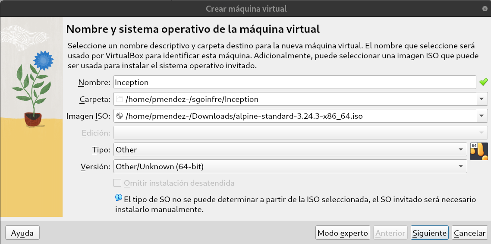

**Name and operating system.** VirtualBox has no Alpine type, so it is **Other / Other/Unknown (64-bit)**. Because it cannot recognise the ISO, the unattended installation is disabled (the *Skip unattended installation* box is grey): Alpine is installed by hand, in [section 2.2](#22-install-alpine-on-the-disk).

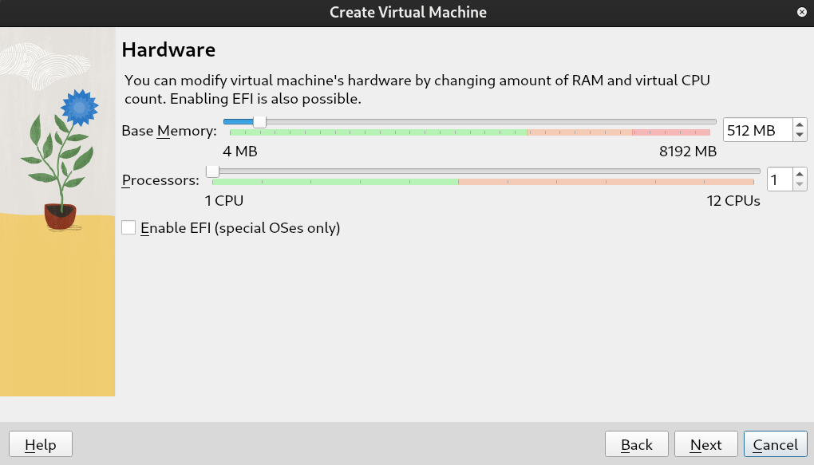

**Hardware.** 4096 MB of RAM and 2 CPUs. Alpine and the three containers run with 2 GB, but the browser inside the VM (to open `https://pmendez.42.fr`) needs more. Never give the VM more than half of the host's RAM. EFI stays **disabled**.

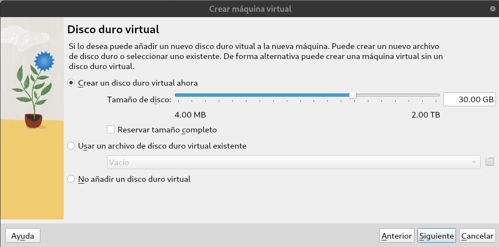

**Virtual hard disk.** 30 GB, with *Pre-allocate full size* **unchecked**: the disk is dynamic, so the `.vdi` file only takes the space really used (1-2 GB at the beginning) and grows when needed. Docker needs room: images, build cache and the volumes of WordPress and MariaDB.

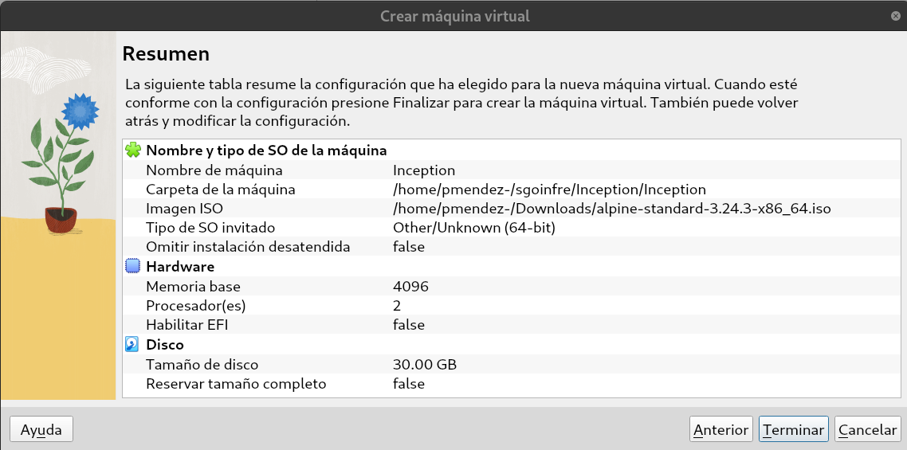

**Summary.** Check the values and click **Finish**.

3. Before booting, open **Settings → Display**:

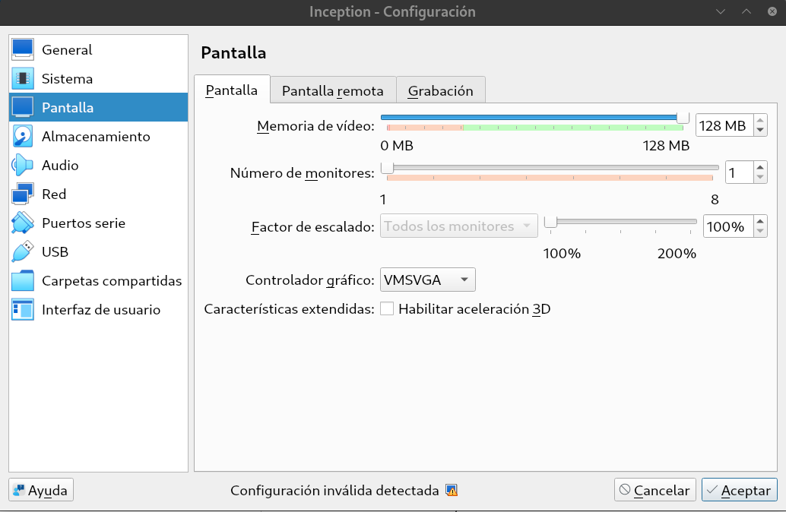

**Display.** Video memory **128 MB**, graphics controller **VMSVGA** and 3D acceleration **disabled**. VMSVGA is the controller that works best with Linux (VBoxVGA is old), and 3D acceleration often causes a black screen or lag. The *Invalid settings detected* message at the bottom is only a warning, because VirtualBox does not know which OS this is: it can be ignored.

4. Optional, to make the VM lighter and faster (same *Settings* window):
   - **System → Boot order**: uncheck *Floppy*.
   - **Network → Adapter 1 → Advanced → Adapter type**: *Paravirtualized network (virtio-net)* or *Intel PRO/1000 MT Desktop* instead of *PCnet-FAST III*, which emulates a very old and slow card.
   - **Audio**: disable it, the project does not need it.

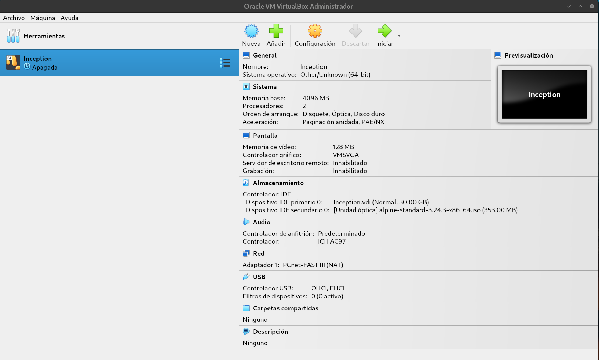

The final configuration of the VM: 4096 MB, 2 CPUs, VMSVGA with 128 MB, the 30 GB disk and the Alpine ISO in the optical drive, ready to boot.

5. Click **Start**.

The VM boots from the ISO. This is only the installer: a live Alpine with nothing installed and no graphical interface.

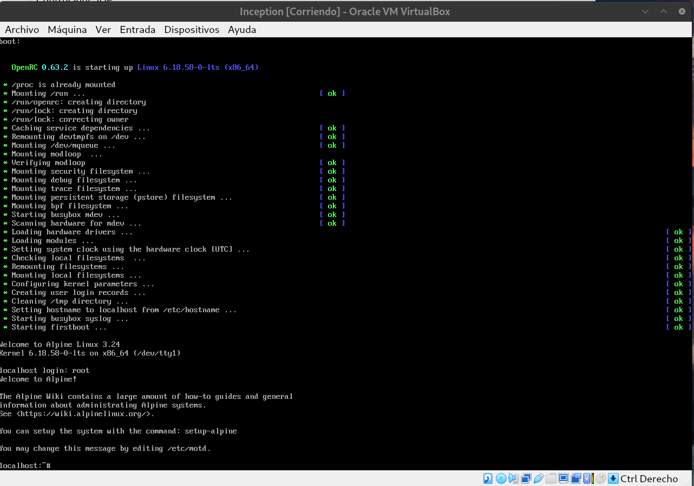

### 2.2 Install Alpine on the disk

Log in as `root` (no password) and run:

```sh
setup-alpine
```

It asks a series of questions. When the answer is **Enter**, the value between brackets `[...]` is already the right one.

#### Step 1. Keyboard

```
Select keyboard layout: [none]
```
→ `es`

```
Select variant (or 'abort'):
```
→ `es`

#### Step 2. Hostname

```
Enter system hostname (fully qualified form, e.g. 'foo.example.org') [localhost]
```
→ `pmendez`

> The hostname cannot end with a hyphen (same rule as the domain), so it is `pmendez`, not `pmendez-`. It is only the name of the VM: the domain `pmendez.42.fr` is configured later, in [section 4](#4-domain-name).

#### Step 3. Network

```
Which one do you want to initialize? (or '?' or 'done') [eth0]
```
→ **Enter**

> The interface may be called `eth1` instead of `eth0`. The name does not matter: press **Enter** anyway. If **both** `eth0` and `eth1` appear, the VM has two network adapters enabled in VirtualBox: initialize `eth0` with `dhcp`, then `eth1` with `dhcp`, and type `done` when it asks again.

```
Ip address for eth0? (or 'dhcp', 'none', '?') [dhcp]
```
→ **Enter** (with NAT, VirtualBox gives the IP automatically)

```
Do you want to do any manual network configuration? (y/n) [n]
```
→ **Enter**

#### Step 4. Root password

```
New password:
Retype password:
```
Type it twice. Nothing is shown while typing: that is normal.

#### Step 5. Timezone

```
Which timezone are you in? [UTC]
```
→ `Europe/Madrid`

#### Step 6. Proxy

```
HTTP/FTP proxy URL? (e.g. 'http://proxy:8080', or 'none') [none]
```
→ **Enter**

#### Step 7. Clock synchronization

```
Which NTP client to run? ('busybox', 'openntpd', 'chrony' or 'none') [chrony]
```
→ **Enter**

#### Step 8. Mirror

A long list of servers is shown, and then:

```
Enter mirror number or URL: [1]
```
→ `f` (for the **fastest** mirror, which is usually the best choice)

#### Step 9. User

```
Setup a user? (enter a lower-case loginname, or 'no') [no]
```
→ `pmendez-`

> A Linux username can end with a hyphen (it only cannot start with one), so the user keeps the full 42 login. That way the data folder `/home/pmendez-/data` is inside the user's own home.

```
Full name for user pmendez- [pmendez-]
```
→ **Enter**

```
New password:
Retype password:
```
Type the user's password twice.

```
Enter ssh key or URL for pmendez- (or 'none') [none]
```
→ **Enter**

#### Step 10. SSH server

```
Which ssh server? ('openssh', 'dropbear' or 'none') [openssh]
```
→ **Enter**

```
Allow root ssh login? ('?' for help) [prohibit-password]
```
→ **Enter**

#### Step 11. Disk

```
Available disks are:
  sda   (32.2 GB ATA      VBOX HARDDISK   )
Which disk(s) would you like to use? (or '?' for help or 'none') [none]
```
→ `sda`

```
How would you like to use it? ('sys', 'data', 'crypt', 'lvm' or '?' for help) [?]
```
→ `sys` (a normal installation on the disk)

```
WARNING: Erase the above disk(s) and continue? (y/n) [n]
```
→ `y`

It takes a while to install.

#### Step 12. Power off

```
Installation is complete. Please reboot.
```

**Do not reboot yet**: the VM would boot the installer again. Run:

```sh
poweroff
```

### 2.3 Remove the ISO and boot from the disk

With the VM powered off, in VirtualBox:

1. **Settings → Storage** → click the optical drive with the ISO → disk icon on the right → **Remove disk from virtual drive**.

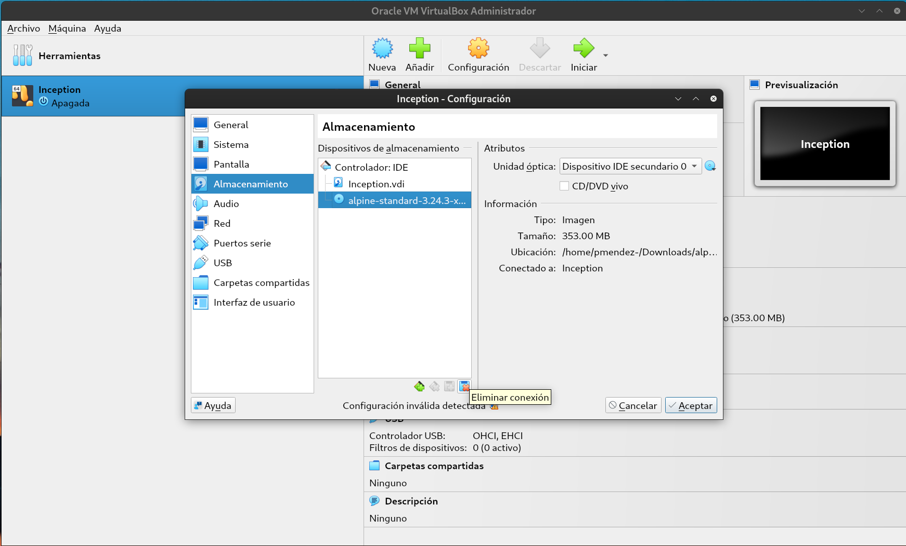

2. **Display** → graphics controller **VMSVGA**, 3D acceleration **disabled**.
3. **OK**, and start the VM.

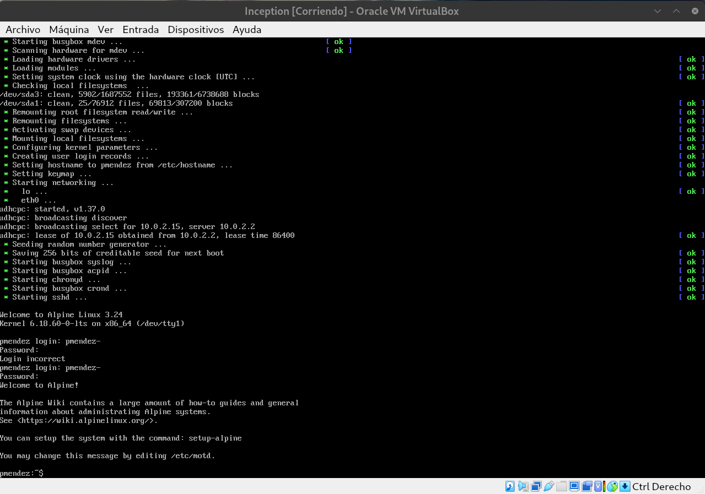

### 2.4 Check the network and the repositories

Before installing anything, check that the VM has network and that `apk` can find packages. `setup-alpine` should leave it ready (step 8), but if the mirror step went wrong, every `apk add` later fails with `no such package`.

Everything in this section and the next one runs as `root`. If you are logged in as `pmendez-` (prompt ending in `$`), become `root` first (it asks for the root password):

```sh
su -
```

The prompt now ends in `#`.

> Running `apk add` as a normal user fails with `ERROR: Unable to open log: Permission denied`: only `root` can install packages. And `sudo` cannot be used yet, because it is installed in the next section.

#### Check 1. Network

```sh
ping -c 3 dl-cdn.alpinelinux.org
```

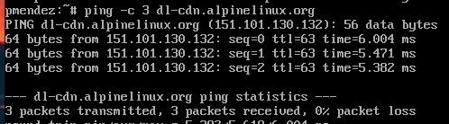

It must end with `3 packets transmitted, 3 packets received, 0% packet loss`.

> If it fails (`bad address` or `Network unreachable`), the problem is the network: check the interface with `ip a` and `cat /etc/network/interfaces`. Do not go on until the `ping` answers.

#### Check 1b. DNS

If `ping` to a name fails with `bad address`, or `git clone` fails with `Could not resolve hostname github.com`, but `ping -c 2 8.8.8.8` answers, the VM has network but cannot translate names into IPs: the problem is the **DNS**.

```sh
cat /etc/resolv.conf
```

By default it shows `nameserver 10.0.2.3`: the DNS of VirtualBox, which forwards every query to the DNS of the host. On the 42 computers the host uses a local DNS (`127.0.0.53`, systemd-resolved), and VirtualBox sometimes fails to forward to it. The fix is to use the real DNS of the host directly. To find it, run on the **host** (not in the VM):

```sh
resolvectl status | grep 'DNS Servers'
```

At 42 Madrid it is `10.51.1.253`. Write it in the VM, with Google's DNS as a backup:

```sh
printf "search 42madrid.com\nnameserver 10.51.1.253\nnameserver 8.8.8.8\n" > /etc/resolv.conf
ping -c 2 github.com
```

This change is lost on the next boot: when the network starts, `udhcpc` (the DHCP client of Alpine) asks VirtualBox for an IP and rewrites `/etc/resolv.conf` with the DNS it receives (`10.0.2.3` again). To stop it from touching the file, uncomment `RESOLV_CONF="no"` in its configuration (it still gets the IP; it only leaves `resolv.conf` alone):

```sh
sed -i 's/^#RESOLV_CONF="no"/RESOLV_CONF="no"/' /etc/udhcpc/udhcpc.conf
grep RESOLV_CONF /etc/udhcpc/udhcpc.conf
```

The first line printed must be `RESOLV_CONF="no"`, without `#`. After a `reboot`, `cat /etc/resolv.conf` must still show `10.51.1.253`.

> This only affects the VM. The containers get their own `resolv.conf` from Docker, and they find each other by name through the `inception` network. But the build needs internet (`apk add`, the download of WP-CLI and WordPress): with a broken DNS, `make` fails.

#### Check 2. Repositories

```sh
cat /etc/apk/repositories
```

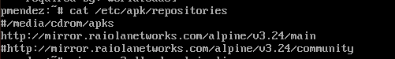

There must be a line ending in `/main` and another one ending in `/community`, **both without `#`** in front.

If `community` is commented with `#`, or the file is empty, or it only has the line of the ISO (`/media/cdrom/apks`), set the official repositories (`-c` enables community, `-1` picks the first mirror, the official CDN):

```sh
setup-apkrepos -c -1
```

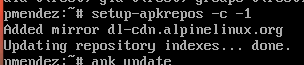

> `setup-apkrepos` adds the new lines below the old ones instead of replacing them. It works the same, but the old mirror can be commented out to keep it clean. Run `cat /etc/apk/repositories` again: the two lines of `dl-cdn.alpinelinux.org` must be there without `#`.

#### Check 3. Package list

```sh
apk update
```

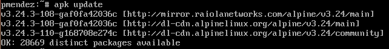

It must print one line for each repository (one for `main`, one for `community`) and end with `OK: ... distinct packages available`, with no `ERROR` or `WARNING` lines.

> If a line shows an `ERROR` with the URL of a mirror, that mirror is failing: comment it out with `#` in `/etc/apk/repositories`, and run `setup-apkrepos -c -1` and `apk update` again.

#### Check 4. Check if repos are enabled

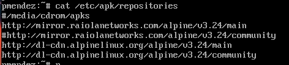

**Install `sudo`:**

```sh
apk add sudo
```

#### Check 5. `apk` finds the packages

`sudo` comes from the `main` repository:

```sh
apk search -e sudo
```

`docker` comes from the `community` repository:

```sh
apk search -e docker
```

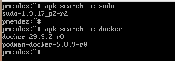

Each one must print the package with its version (for example `sudo-1.9.17_p2-r2`), installed or not. Together they prove that both repositories work.

### 2.5 Grant sudo

Still as `root`:

```sh
adduser pmendez- wheel
```

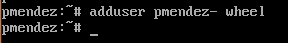

```sh
visudo
```

In `visudo`, make sure this line is present and uncommented (the `%` means *group*):

```
%wheel ALL=(ALL:ALL) NOPASSWD: ALL
```

> `visudo` opens the `vi` editor: move to the line with the arrows, put the cursor on the `#` and press `x` twice (it deletes the `#` and the space), then type `:wq` and Enter to save and exit.

> There are two similar lines, one above the other. Uncomment only the one with `NOPASSWD`:
>
> ```
> # %wheel ALL=(ALL:ALL) ALL                ← asks for the password: leave it commented
> %wheel ALL=(ALL:ALL) NOPASSWD: ALL        ← uncomment this one
> ```
>
> If `sudo` asks `[sudo] password for pmendez-:`, the wrong line was uncommented. Type the password of `pmendez-`, fix it with `sudo visudo`, and check with `sudo grep -n wheel /etc/sudoers` that the only line without `#` is the `NOPASSWD` one.

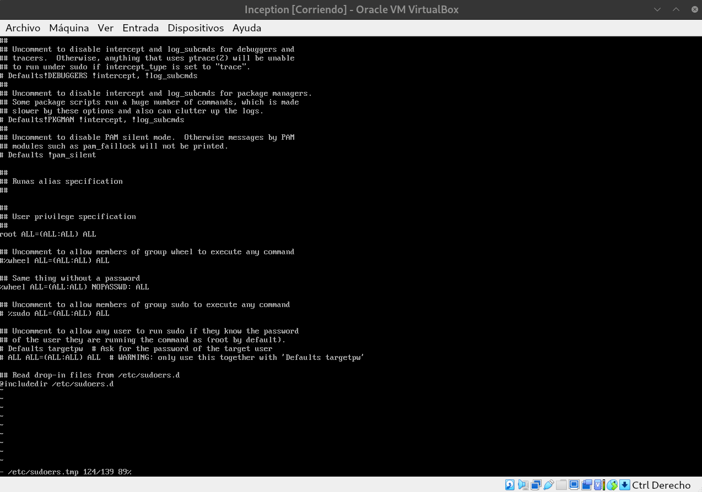

The new group only applies to new sessions. Log out completely (`exit` until the login screen appears) and log in again as `pmendez-`.

Show the groups of the user. It must list `wheel`:

```sh
id
```

Make sudo forget any password typed before, so the next check is real:

```sh
sudo -k
```

Run a command with sudo. It must answer `root` **without asking for a password**:

```sh
sudo whoami
```

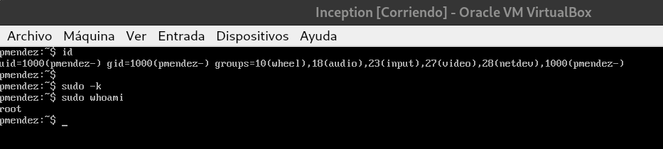

### 2.6 Graphical interface (XFCE)

Alpine has no desktop by default. XFCE is light and runs smoothly in a VM. Run everything as `pmendez-`, with `sudo`.

#### Install the desktop

Alpine's `setup-desktop` script installs Xorg, XFCE, LightDM (the graphical login screen) and dbus, and enables their services:

```sh
sudo setup-desktop xfce
```

Check that the three main packages are installed. It must print `xfce4`, `lightdm` and `dbus`:

```sh
apk info -e xfce4 lightdm dbus
```

> If one is missing, `setup-desktop` stopped halfway (for example, because the network went down while it was running). Check the network ([section 2.4](#24-check-the-network-and-the-repositories)) and run `sudo setup-desktop xfce` again: it keeps what is installed and completes the rest.

#### Load the drivers on every boot

`setup-desktop` changes the device manager of Alpine from `mdev` to `udev`, the service that loads the drivers when the system boots. In this VM, after that change, the drivers were not loaded at boot: there was no network (`ip link` only showed `lo`) and no graphics card (`/dev/dri/card0` did not exist). To be safe, list both drivers in `/etc/modules`, the file of drivers that Alpine always loads at boot.

Find the network card. It prints the path of the device whose class is `0x0200` (Ethernet):

```sh
grep -l 0x0200 /sys/bus/pci/devices/*/class
```

Show its manufacturer, using the folder printed above (here `0000:00:03.0`):

```sh
cat /sys/bus/pci/devices/0000:00:03.0/vendor
```

| Vendor | VirtualBox adapter type | Driver |
|---|---|---|
| `0x1022` | PCnet-FAST III | `pcnet32` |
| `0x8086` | Intel PRO/1000 MT | `e1000` |
| `0x1af4` | Paravirtualized network (virtio-net) | `virtio_net` |

Add the network driver (here `pcnet32`, the default adapter of VirtualBox):

```sh
echo pcnet32 | sudo tee -a /etc/modules
```

Add the graphics driver of the VMSVGA controller:

```sh
echo vmwgfx | sudo tee -a /etc/modules
```

Check the file. Both drivers must be at the end:

```sh
cat /etc/modules
```

#### Graphics

Install the Mesa drivers (3D rendering done by the CPU, used by the desktop):

```sh
sudo apk add mesa-dri-gallium
```

> **Do not install `xf86-video-vmware`.** It is the old Xorg driver for VMware/VMSVGA graphics, and it crashes Xorg: it tries to access the memory of the graphics card directly, but the kernel driver `vmwgfx` already owns it. The log shows `(EE) vmware(0): Unable to map mmio BAR` followed by `Segmentation fault`, and the screen stays black. Without it, Xorg uses its generic driver, `modesetting`, which works on top of `vmwgfx`. If it was installed, remove it with `sudo apk del xf86-video-vmware`.

#### VirtualBox guest additions

Check the name of the VirtualBox guest additions packages:

```sh
apk search virtualbox-guest
```

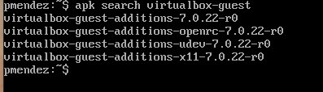

Install them (automatic screen resizing and shared clipboard):

```sh
sudo apk add virtualbox-guest-additions virtualbox-guest-additions-x11
```

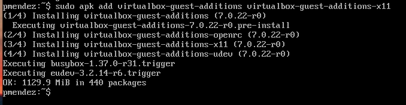

> If `apk` says `no such package`, install only the names printed by `apk search virtualbox-guest`.

Start the guest additions on every boot:

```sh
sudo rc-update add virtualbox-guest-additions default
```

#### Services

LightDM needs dbus: without it, its log shows `Failed to get system bus` and the login screen does not appear. Check that both start on every boot. It must show `dbus | default` and `lightdm | default`:

```sh
rc-update show default
```

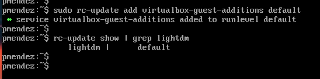

If `dbus` is missing, add it:

```sh
sudo rc-update add dbus default
```

#### Reboot

```sh
sudo reboot
```

The graphical login screen appears. Log in as `pmendez-`.

> The keyboard of the desktop is configured apart from the text console. If it types in English, go to **Applications → Settings → Keyboard → Layout**, uncheck *Use system defaults*, add **Spanish** and remove **English**.

#### If the screen stays black

With a black screen, the keyboard shortcuts to go back to the text console may not work. Two ways to get a terminal:
- Restart the VM from the VirtualBox menu, **Machine → Reset**, and log in on the text console before LightDM starts, or
- connect from the host by SSH (`sshd` is running).

Then read the logs.

Status of the services. `udev`, `dbus` and `lightdm` must be `started`:

```sh
rc-status
```

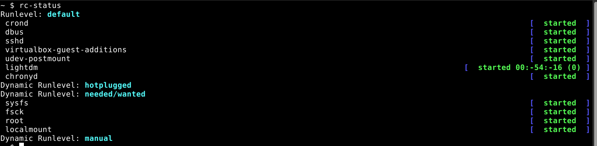

Log of LightDM. `greeter display server failed to start` means that Xorg crashed:

```sh
sudo tail -n 40 /var/log/lightdm/lightdm.log
```

Log of Xorg. The reason of a crash is at the end, not always in an `(EE)` line:

```sh
sudo tail -n 50 /var/log/lightdm/x-0.log
```

If the log is not enough, start Xorg by hand on a separate display (`:1`), with full detail. Stop it with **Ctrl+C** if it does not end by itself (that means it started fine):

```sh
sudo Xorg :1 -verbose 7 2>&1 | tail -n 60
```

After fixing the problem, start the login screen again without rebooting:

```sh
sudo rc-service lightdm restart
```

---

## 3. Docker installation

Install Docker and the Compose plugin:

```sh
sudo apk add docker docker-cli-compose
```

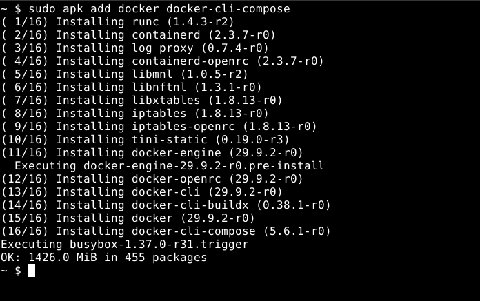

Start Docker on every boot:

```sh
sudo rc-update add docker default
```

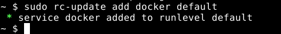

Start it now:

```sh
sudo rc-service docker start
sudo rc-service docker status
```

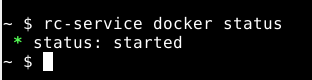

Add the user to the `docker` group, to use `docker` without `sudo`:

```sh
sudo adduser pmendez- docker
id pmendez-
```

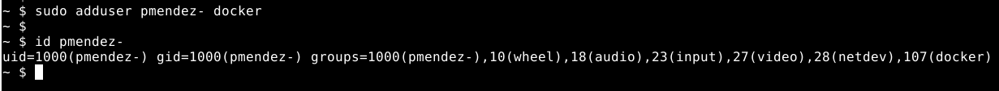

The new group only applies to new sessions: log out completely and log in again as `pmendez-`.

Check the Docker version:

```sh
docker --version
```

Check the Compose version:

```sh
docker compose version
```

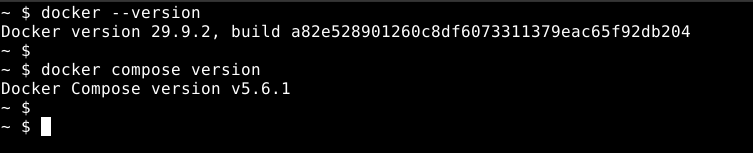

Run a test container. It must print `Hello from Docker!`:

```sh
docker run --rm hello-world
```

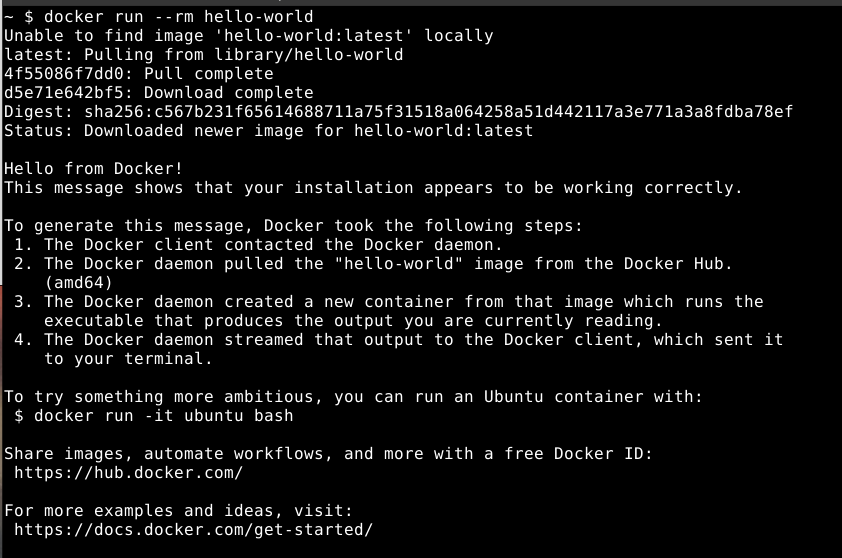

---

## 4. Domain name

The site must be reachable at `pmendez.42.fr`. That name does not exist on the Internet, so we tell the VM that it points to itself (`127.0.0.1`):

```sh
echo "127.0.0.1 pmendez.42.fr" | sudo tee -a /etc/hosts
```

Comprobacion de hostname cambiado

```bash
getent hosts pmendez.42.fr
```

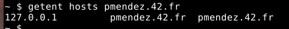

---

## 5. Add VirtualBox Guest Additions

```bash
VBoxClient --vmsvga
```

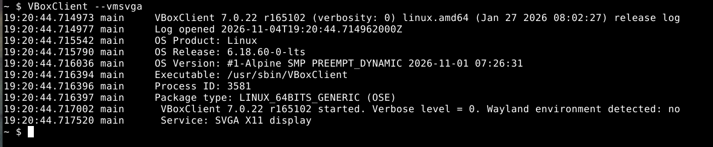

Como hago que se lance cada vez que inicias sesión

```bash
mkdir -p ~/.config/autostart
cat > ~/.config/autostart/vboxclient-vmsvga.desktop << 'EOF'
[Desktop Entry]
Type=Application
Name=VBoxClient VMSVGA
Exec=VBoxClient --vmsvga
X-GNOME-Autostart-enabled=true
EOF
```

Despues de reiniciar, lanza este comando:

```bash
pgrep -a VBoxClient 
```

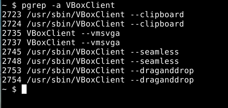

## 6. Editor (optional): VS Code via Flatpak

The official VS Code build does not run natively on Alpine (musl), so it is installed through Flatpak:

```sh
sudo apk add flatpak dbus dbus-x11 xdg-desktop-portal xdg-desktop-portal-gtk
sudo rc-update add dbus default
sudo rc-service dbus start
sudo flatpak remote-add --if-not-exists flathub https://flathub.org/repo/flathub.flatpakrepo
sudo flatpak install -y flathub com.visualstudio.code
```

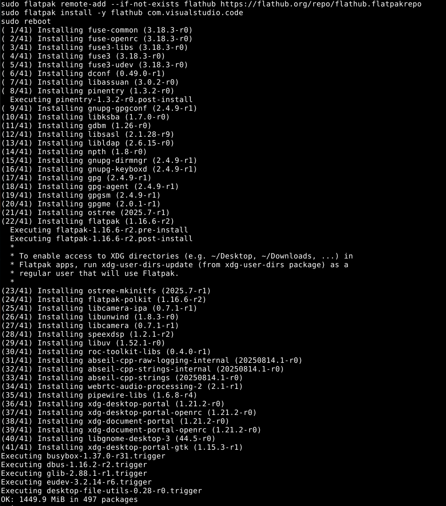

Optional `code` command:

```sh
printf '#!/bin/sh\nexec flatpak run com.visualstudio.code "$@"\n' | sudo tee /usr/local/bin/code
sudo chmod +x /usr/local/bin/code
```

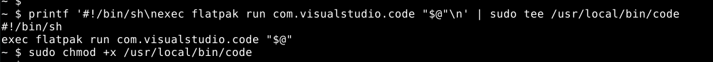

---

## 6. How the project works

### 6.1 The big picture

The project runs three containers. Each one does **one** job:

| Container | Job | Port | Reachable from |
|---|---|---|---|
| `nginx` | Web server. Receives every request over HTTPS | 443 | The outside world (the **only** entry point) |
| `wordpress` | Runs the PHP code of WordPress (PHP-FPM) | 9000 | Only inside the Docker network |
| `mariadb` | Database: posts, users, settings | 3306 | Only inside the Docker network |

```
 Browser
    │  https://pmendez.42.fr  (port 443, TLS)
    ▼
┌──────────────────────────── Docker network "inception" ────────────────────────────┐
│                                                                                     │
│   NGINX ──── "run index.php" (9000) ────▶ WORDPRESS ──── SQL (3306) ────▶ MARIADB   │
│     │                                         │                             │       │
└─────┼─────────────────────────────────────────┼─────────────────────────────┼───────┘
      │                                         │                             │
      └──────────▶  volume "wordpress"  ◀───────┘                volume "mariadb"
                 /home/pmendez-/data/wordpress            /home/pmendez-/data/mariadb
```

### 6.2 Two kinds of connection

The containers are connected in **two different ways**, and each one has a different purpose.

**1. The network: containers *talk* to each other.**
Docker creates a private network called `inception` and puts the three containers in it. Inside that network, each container can be reached by its **name**, as if it were a hostname:

- nginx sends PHP requests to `wordpress:9000` (`fastcgi_pass` in `nginx.conf`).
- WordPress connects to the database at `mariadb:3306` (`--dbhost` in `wp-installer.sh`).

Only nginx publishes a port to the host (`443:443`). Ports 9000 and 3306 are **not** reachable from outside the network.

**2. The volumes: containers *share files*.**
A volume is a folder on the VM that Docker plugs into one or more containers:

- The `wordpress` volume is mounted at `/var/www/html` in **both** nginx and wordpress. WordPress writes its files there, and nginx reads them from there. It is the same folder, not a copy.
- The `mariadb` volume is mounted at `/var/lib/mysql` in mariadb. The database files live there.

Because the data lives on the VM and not inside the containers, it **survives** when containers are stopped, removed or rebuilt.

### 6.3 What happens when someone visits the site

1. The browser asks for `https://pmendez.42.fr/`. The request reaches **nginx** on port 443.
2. nginx checks the URL against its config:
   - A static file (CSS, image, JS)? nginx reads it from `/var/www/html` (the shared volume) and sends it back. PHP is not involved.
   - A `.php` file, or a "pretty" URL like `/hello-world/`? nginx forwards the request to **PHP-FPM** at `wordpress:9000`.
3. PHP-FPM runs `/var/www/html/index.php`. It can find it because it sees the same shared volume.
4. WordPress needs the posts, so it queries **MariaDB** at `mariadb:3306`.
5. PHP builds the HTML page and returns it to nginx, which sends it to the browser.

### 6.4 Build time vs. start time

Each service has two moments, and confusing them is the most common source of errors:

| | **Dockerfile** | **Script in `tools/`** |
|---|---|---|
| When it runs | Once, when the image is built (`make build`) | Every time the container starts (`make`) |
| What it does | Installs programs, copies config files | Configures the service, then starts it |
| Has access to secrets, `.env`, volumes, other containers? | **No** | **Yes** |

This is why WordPress cannot be fully installed in the Dockerfile: at build time the database is not running and the passwords are not available.

### 6.5 PID 1: the main process of a container

#### What PID 1 is

Every running program is a **process**, and every process has a number: its **PID** (*Process ID*). The first process started inside a container gets the number **1**. It is the container's **main process**.

Docker follows one simple rule:

> **A container lives exactly as long as its PID 1 lives.** When PID 1 ends, the container stops.

So PID 1 must be the server itself (nginx, PHP-FPM, MariaDB), and it must keep running.

#### Rule 1: the server must run in the foreground

Many servers, when started, go to the **background** (they become a *daemon*): they create a copy of themselves that keeps working, and the original process ends. On a normal computer this is fine. In a container it is not:

```
Server in the background:
  PID 1 = nginx  →  creates a copy in the background  →  PID 1 ends
  Docker: "PID 1 has ended"  →  stops the container ❌

Server in the foreground:
  PID 1 = nginx  →  keeps working itself
  Docker: "PID 1 is alive"   →  the container keeps running ✅
```

That is why every server is started in the **foreground**:

| Container | PID 1 | How it stays in the foreground |
|---|---|---|
| nginx | `nginx -g "daemon off;"` | `daemon off;` = "do not go to the background" |
| wordpress | `php-fpm83 -F` | `-F` = *foreground* |
| mariadb | `mariadbd --user=mysql` | `mariadbd` stays in the foreground by default |

#### Rule 2: PID 1 receives the stop signals

A **signal** is a message sent to a process. Two matter here:

| Signal | Meaning | What the process can do |
|---|---|---|
| `SIGTERM` | "Please stop" | Finish its current work, save, close its files, then exit |
| `SIGKILL` | "Stop now" | Nothing: it is killed instantly |

When a container is stopped (`make down`, `docker stop`), Docker:

1. Sends `SIGTERM` **only to PID 1**.
2. Waits up to **10 seconds**.
3. If the container is still running, sends `SIGKILL`.

So PID 1 must be the server, because it is the only process that gets the "please stop" message:

```
✅ The server is PID 1:
Docker ──SIGTERM──▶ PID 1 = mariadbd
                    finishes writing, closes the database, exits
                    → clean stop in 1-2 seconds

❌ A script is PID 1 and the server is its child:
Docker ──SIGTERM──▶ PID 1 = sh initialize.sh   (the shell ignores it)
                         └── mariadbd           (never receives it)
        ...10 seconds...
Docker ──SIGKILL──▶ everything is killed instantly
                    → MariaDB may be stopped in the middle of a write
```

#### How this project does it: `exec`

The WordPress and MariaDB containers start with a script (`tools/*.sh`), so at first **the script** is PID 1. The script:

1. Does its one-time setup (install WordPress, create the database).
2. Ends with `exec <server>`:

```sh
exec mariadbd --user=mysql     # mariadb/tools/initialize.sh
exec php-fpm83 -F              # wordpress/tools/wp-installer.sh
```

`exec` **replaces** the script with the server. It does not start a new process: the same process, with the same PID 1, now runs the server. Without `exec`, the server would be a child of the script, and the script would stay as PID 1 (the bad case above).

nginx does not need a script: the Dockerfile's `CMD` starts nginx directly, so it is PID 1 from the beginning.

#### Why infinite loops are forbidden

A common shortcut is to start the server in the background and keep the container alive with a command that never ends: `tail -f`, `sleep infinity`, `while true`. The subject forbids it, and for good reasons:

- PID 1 is `tail`, not the server, so **the server never receives `SIGTERM`** and is killed after 10 seconds.
- **If the server crashes, the container keeps "running"** (the loop is still alive). Docker does not notice anything, and `restart: unless-stopped` never restarts it.

With the server as PID 1, the container's state is the server's state: if the server crashes, the container stops and Docker restarts it.

#### Check it

```sh
# Who is PID 1 in each container
for c in nginx wordpress mariadb; do
  printf '%s: ' $c; docker exec $c cat /proc/1/cmdline | tr '\0' ' '; echo
done

# A clean stop takes 1-2 seconds; ~10 seconds would mean PID 1 ignored SIGTERM
time docker stop mariadb
docker start mariadb
```

---

## 7. Project files, one by one

```
.
├── Makefile                         → entry point: builds and starts everything
├── DEV_DOC.md / USER_DOC.md / README.md
├── secrets/                         → passwords (ignored by git)
│   ├── db_password.txt
│   ├── db_root_password.txt
│   ├── wp_admin_password.txt
│   └── wp_user_password.txt
└── srcs/
    ├── .env                         → non-secret settings (ignored by git)
    ├── docker-compose.yml           → defines and connects the 3 containers
    └── requirements/
        ├── nginx/
        │   ├── Dockerfile
        │   └── conf/nginx.conf
        ├── wordpress/
        │   ├── Dockerfile
        │   └── tools/wp-installer.sh
        └── mariadb/
            ├── Dockerfile
            ├── conf/mariadb-conf.cnf
            └── tools/initialize.sh
```

Every service follows the same pattern: a **Dockerfile** with numbered steps, a **conf/** folder with configuration, and a **tools/** script that (1) reads the secrets, (2) does a one-time setup, and (3) `exec`s the server.

### 7.1 `srcs/docker-compose.yml`

Describes the three services and how they are connected.

| Key | What it does |
|---|---|
| `build: requirements/<service>` | Builds the image from our own Dockerfile (no ready-made images) |
| `image: <service>:inception` | The image gets the same name as its service (subject requirement), with the tag `inception`. Without a tag, Docker would name it `<service>:latest`, and the `latest` tag is forbidden |
| `container_name` | Fixed name, so we can write `docker exec nginx ...` |
| `ports: "${NGINX_PORT}:${NGINX_PORT}"` | Only in nginx: `VM port : container port` (`443:443` by default) |
| `env_file: .env` | Loads the non-secret variables into the container |
| `secrets:` | Each secret file appears in the container as `/run/secrets/<name>` |
| `volumes:` | Plugs a named volume into a folder of the container |
| `networks: inception` | Puts the container in the private network |
| `depends_on:` | Start order: mariadb → wordpress → nginx |
| `restart: unless-stopped` | Docker restarts the container if it crashes |

The bottom of the file defines the shared pieces:

- **`networks.inception`**: a `bridge` network, Docker's private network type.
- **`volumes.wordpress` / `volumes.mariadb`**: named volumes whose data is stored in `/home/pmendez-/data/...` (`driver_opts` with `device:` tells Docker *where* on the VM to keep the data).
- **`secrets`**: maps each secret name to its file in `../secrets/`.

### 7.2 nginx

**`Dockerfile`**

1. Installs `nginx` and `openssl`.
2. Creates a **self-signed TLS certificate** for `pmendez.42.fr` (`openssl req -x509 ...`). "Self-signed" means no authority signed it, so the browser shows a warning. That is expected.
3. Copies `conf/nginx.conf` over Alpine's default site config.
4. Writes `NGINX_PORT` (443 by default) in `listen` and `PHP_PORT` in `fastcgi_pass`, then exposes `NGINX_PORT`.
5. Starts nginx in the foreground (`daemon off;`).

**`conf/nginx.conf`**

| Directive | Meaning |
|---|---|
| `listen 443 ssl;` | Only HTTPS. There is no port 80. The Dockerfile replaces `443` with `NGINX_PORT` from `.env` during the build |
| `ssl_protocols TLSv1.2 TLSv1.3;` | Older, insecure TLS versions are refused |
| `root /var/www/html;` | Where the website files are: the shared `wordpress` volume |
| `try_files $uri $uri/ /index.php?$args;` | Is it a file? Serve it. A folder? Serve its index. Otherwise let WordPress (`index.php`) handle it |
| `location ~ \.php$` | For URLs ending in `.php`… |
| `fastcgi_pass wordpress:9000;` | …send them to PHP-FPM in the `wordpress` container. The Dockerfile replaces `9000` with `PHP_PORT` from `.env` during the build |
| `fastcgi_param SCRIPT_FILENAME ...` | …and tell PHP-FPM which file to run (e.g. `/var/www/html/index.php`) |

### 7.3 WordPress

**`Dockerfile`**

1. Installs PHP 8.3, PHP-FPM, the PHP extensions WordPress needs, `curl` and the MariaDB client.
2. Links `php` → `php83`, because WP-CLI looks for a program called `php`.
3. Makes PHP-FPM listen on `PHP_PORT` (from `.env`, passed as a build arg) instead of `127.0.0.1:9000`, so other containers (nginx) can reach it.
4. Raises PHP's `memory_limit` to 512M. WP-CLI needs it to unpack WordPress.
5. Downloads **WP-CLI** (`/usr/local/bin/wp`), the command-line tool used to install WordPress.
6. Copies the start script.
7. Sets `/var/www/html` as the working directory (where the volume is mounted).
8. Exposes `PHP_PORT`.
9. Runs the script on start.

**`tools/wp-installer.sh`**, run at every start:

1. Reads the three passwords from `/run/secrets/`.
2. Waits until MariaDB answers (`mariadb-admin ping`), at most 60 tries of 2 seconds. On the very first start, the database needs a few seconds to initialise. If it never answers, the script exits with an error and Docker restarts the container, so it is never an infinite loop.
3. **Only if `wp-config.php` does not exist yet** (first start), installs WordPress:
   1. `wp core download`: downloads the WordPress files into the volume.
   2. `wp config create`: writes `wp-config.php` (database name, user, password, host `mariadb:$DB_PORT`).
   3. `wp core install`: creates the tables in MariaDB, the site title and the **administrator** account.
   4. `wp user create`: creates the second, non-admin user (role `author`).
4. On every start: `wp config set DB_HOST "mariadb:$DB_PORT"` and `wp option update home/siteurl` with `https://$DOMAIN_NAME` (plus `:$NGINX_PORT` when it is not 443), so WordPress follows `DB_PORT` and `NGINX_PORT` if they change.
5. Gives the files to `nobody`, the user PHP-FPM runs as, so WordPress can write (uploads, plugins).
6. `exec php-fpm83 -F`: PHP-FPM becomes PID 1.

On the next starts `wp-config.php` already exists in the volume, so step 3 is skipped.

### 7.4 MariaDB

**`Dockerfile`**

1. Installs the MariaDB server and client.
2. Creates `/run/mysqld`, the folder for the local socket (used to connect from inside the container).
3. Copies `conf/mariadb-conf.cnf` over Alpine's default config, which blocks network connections.
4. Copies the start script.
5. Exposes `DB_PORT`.
6. Runs the script on start.

**`conf/mariadb-conf.cnf`**

| Option | Meaning |
|---|---|
| `bind-address = 0.0.0.0` | Accept connections from other containers (WordPress), not only from inside |
| `port = 3306` | Standard MariaDB port. The Dockerfile replaces it with `DB_PORT` from `.env` during the build |
| `datadir = /var/lib/mysql` | Where the data is stored: the `mariadb` volume |
| `socket = /run/mysqld/mysqld.sock` | Local socket file for connections from inside the container |

**`tools/initialize.sh`**, run at every start:

1. Reads `db_password` and `db_root_password` from `/run/secrets/`.
2. **Only if `/var/lib/mysql/mysql` does not exist yet** (first start):
   1. `mariadb-install-db`: creates MariaDB's internal system tables.
   2. Runs the SQL setup with `mariadbd --bootstrap`: MariaDB reads the SQL, applies it and exits by itself. Nothing runs in the background and no network is opened:
      - removes the anonymous users and the `test` database;
      - creates the WordPress database (`DB_NAME`);
      - creates the WordPress user (`DB_USER`) with access from any container (`'%'`);
      - sets the `root` password.
3. `exec mariadbd --user=mysql`: the real MariaDB becomes PID 1.

### 7.5 `Makefile`

See [section 9](#9-build-and-run).

---

## 8. Configuration from scratch: `.env` and secrets

Configuration is split in two:

| | `srcs/.env` | `secrets/*.txt` |
|---|---|---|
| Contains | Non-sensitive settings (names, domain, emails) | Passwords only |
| Reaches the container as | Environment variables | Files in `/run/secrets/<name>` |
| Visible with `docker inspect`? | Yes | No |
| In git? | **No** (`.gitignore`) | **No** (`.gitignore`) |

> No password may ever appear in a Dockerfile, in `.env` or in git. Passwords found in the repository mean the project fails.

### 8.1 Create `srcs/.env`

```sh
cat > srcs/.env << 'EOF'
# Domain
DOMAIN_NAME=pmendez.42.fr

# Database
DB_NAME=wordpress
DB_USER=wpuser

# Internal ports (only inside the Docker network)
DB_PORT=3306
PHP_PORT=9000

# HTTPS port of nginx (the only one published to the host)
NGINX_PORT=443

# WordPress (the admin username must NOT contain "admin")
WP_TITLE=Inception
WP_ADMIN_USER=pmendez_boss
WP_ADMIN_EMAIL=pmendez-@student.42.fr
WP_USER=pmendez_user
WP_USER_EMAIL=user@student.42.fr
EOF
```

| Variable | Used by | Meaning |
|---|---|---|
| `DOMAIN_NAME` | wordpress | Site URL (`https://$DOMAIN_NAME`) |
| `DB_NAME` | mariadb, wordpress | Name of the WordPress database |
| `DB_USER` | mariadb, wordpress | Database user WordPress connects with |
| `DB_PORT` | mariadb (build), wordpress | Port MariaDB listens on; WordPress connects to it |
| `PHP_PORT` | wordpress (build), nginx (build) | Port PHP-FPM listens on; nginx sends `.php` requests to it |
| `NGINX_PORT` | nginx (build), docker compose (`ports:`), wordpress | HTTPS port of the site. WordPress adds it to its address when it is not 443 |
| `WP_TITLE` | wordpress | Site title |
| `WP_ADMIN_USER` / `WP_ADMIN_EMAIL` | wordpress | Administrator account. Must not contain `admin` / `Admin` / `administrator` |
| `WP_USER` / `WP_USER_EMAIL` | wordpress | Second, non-admin account |

### 8.2 Create the secrets

One file per password. Here they are generated randomly:

```sh
mkdir -p secrets
openssl rand -base64 18 > secrets/db_password.txt
openssl rand -base64 18 > secrets/db_root_password.txt
openssl rand -base64 18 > secrets/wp_admin_password.txt
openssl rand -base64 18 > secrets/wp_user_password.txt
chmod 600 secrets/*
```

| File | Name inside the container | Used by | Meaning |
|---|---|---|---|
| `db_password.txt` | `/run/secrets/db_password` | mariadb, wordpress | Password of `DB_USER` |
| `db_root_password.txt` | `/run/secrets/db_root_password` | mariadb | Password of MariaDB's `root` |
| `wp_admin_password.txt` | `/run/secrets/wp_admin_password` | wordpress | Password of `WP_ADMIN_USER` |
| `wp_user_password.txt` | `/run/secrets/wp_user_password` | wordpress | Password of `WP_USER` |

> The passwords are only applied on the **first** start. Changing a secret later does not change an existing database or WordPress install. To apply new values, reset the data ([section 11.3](#113-starting-again-from-zero)).

### 8.3 Check that nothing secret is tracked by git

```sh
git check-ignore -v srcs/.env secrets/db_password.txt   # both must be listed
git ls-files secrets srcs/.env                          # must print nothing
```

---

## 9. Build and run

Run everything from the project root.

### 9.1 Makefile targets

| Command | What it does |
|---|---|
| `make` | Checks `.env` and the secrets, creates the data folders, builds the 3 images, starts the containers |
| `make build` | Checks `.env` and the secrets, creates the data folders and builds the images (does not start them) |
| `make check_config` | Only checks that `srcs/.env` has every variable filled in, that `WP_ADMIN_USER` does not contain `admin`, and that the 4 files in `secrets/` exist and are not empty |
| `make up-<service>` | Starts one service, e.g. `make up-nginx` |
| `make down` | Stops and removes the containers. **Data is kept** |
| `make clean` | `down` + `docker system prune -a --volumes -f` + deletes `/home/pmendez-/data` (with `sudo`) |
| `make re` | `clean` then `make`: full rebuild from zero |

> ⚠️ `make clean` runs `docker system prune -a`, which removes **all** unused Docker images, containers and volumes on the machine, not only this project's. It also deletes the website and the database.

### 9.2 What `make` does, step by step

1. **`check_config`**: stops with a red message naming what is missing if `srcs/.env` or any secret is missing or empty (see [section 8](#8-configuration-from-scratch-env-and-secrets)). Without it, `docker compose` would fail with a less clear error, or MariaDB would start with an empty password.
2. **`create_dirs`**: `sudo mkdir -p /home/pmendez-/data/wordpress /home/pmendez-/data/mariadb`. The volumes need these folders to exist.
3. **`build`**: `docker compose -f srcs/docker-compose.yml build` runs the three Dockerfiles.
4. **`up -d`**: creates the network, the volumes and the containers, then starts them in the background, in `depends_on` order:
   1. **mariadb**: on the first start it initialises the database (a few seconds), then serves on 3306.
   2. **wordpress**: waits for MariaDB; on the first start it downloads and installs WordPress (about a minute), then PHP-FPM serves on 9000.
   3. **nginx**: serves HTTPS on 443.

### 9.3 Check that it works

```sh
docker ps                                  # the 3 containers must be "Up"
docker logs wordpress                      # must end with "Arrancando PHP-FPM..."
docker logs mariadb                        # must show "ready for connections"
```

Then open `https://pmendez.42.fr` in the browser. The browser warns about the self-signed certificate: accept it to continue.

| URL | Page |
|---|---|
| `https://pmendez.42.fr` | The website |
| `https://pmendez.42.fr/wp-admin` | Administration panel (log in with `WP_ADMIN_USER` and `secrets/wp_admin_password.txt`) |

Check TLS from the terminal:

```sh
curl -kI https://pmendez.42.fr                       # works
curl -kI --tlsv1.1 --tls-max 1.1 https://pmendez.42.fr  # must fail (TLS 1.1 refused)
curl -I http://pmendez.42.fr                         # must fail (no port 80)
```

---

## 10. Managing containers, volumes and network

The compose project is called `srcs` (the name of the folder that holds `docker-compose.yml`), so Docker prefixes the volumes and the network with `srcs_`.

### 10.1 Containers

```sh
docker ps                                   # running containers
docker ps -a                                # also the stopped ones
docker compose -f srcs/docker-compose.yml logs -f        # follow all logs
docker logs -f wordpress                    # follow one container's logs
docker exec -it wordpress sh                # open a shell inside a container
docker compose -f srcs/docker-compose.yml restart nginx  # restart one service
docker exec nginx cat /proc/1/cmdline | tr '\0' ' '     # see a container's PID 1
```

### 10.2 WordPress (WP-CLI inside the container)

```sh
docker exec wordpress wp user list --allow-root        # list WordPress users
docker exec wordpress wp option get siteurl --allow-root
```

### 10.3 Database

```sh
# Connect as root (asks nothing: the password is read from the secret)
docker exec -it mariadb sh -c 'mariadb -u root -p"$(cat /run/secrets/db_root_password)"'

# Inside MariaDB:
SHOW DATABASES;
SELECT User, Host FROM mysql.user;
USE wordpress; SHOW TABLES;
```

### 10.4 Volumes

```sh
docker volume ls                        # srcs_wordpress, srcs_mariadb
docker volume inspect srcs_wordpress    # "device" shows the folder on the VM
ls /home/pmendez-/data/wordpress        # the WordPress files, seen from the VM
```

To see that both containers share the same files:

```sh
docker exec nginx     ls /var/www/html
docker exec wordpress ls /var/www/html  # same list
```

### 10.5 Network

```sh
docker network ls                       # srcs_inception
docker network inspect srcs_inception   # lists the 3 containers and their IPs
```

---

## 11. Data persistence

### 11.1 Where the data lives

| Volume | Path in the container | Path on the VM | Contents |
|---|---|---|---|
| `srcs_wordpress` | `/var/www/html` (nginx and wordpress) | `/home/pmendez-/data/wordpress` | WordPress files, `wp-config.php`, uploads |
| `srcs_mariadb` | `/var/lib/mysql` (mariadb) | `/home/pmendez-/data/mariadb` | Database files |

Both are **named volumes** (declared under `volumes:` in `docker-compose.yml`), not bind mounts. `driver_opts.device` only tells Docker in which VM folder to keep their data.

### 11.2 What survives what

| Action | Containers | Data |
|---|---|---|
| A container crashes | Restarted automatically (`restart: unless-stopped`) | Kept |
| `make down` then `make` | Recreated | Kept: WordPress is **not** reinstalled |
| Rebuilding images (`make build`) | Recreated from the new image | Kept |
| Rebooting the VM | Restarted when Docker starts | Kept |
| `make clean` / `make re` | Removed | **Deleted** |

The start scripts detect existing data: MariaDB checks for `/var/lib/mysql/mysql`, WordPress checks for `wp-config.php`. If they exist, the one-time setup is skipped.

### 11.3 Starting again from zero

```sh
make down
sudo rm -rf /home/pmendez-/data       # needs sudo: the files belong to the container users
docker volume rm srcs_wordpress srcs_mariadb
make
```

---

## 12. Troubleshooting

| Symptom | Cause | Fix |
|---|---|---|
| `wordpress` logs repeat `Esperando a MariaDB...` | MariaDB not ready yet, or wrong DB credentials | Wait a few seconds; check `docker logs mariadb`; check that `DB_USER` and `db_password` match |
| `Allowed memory size ... exhausted` during `wp core download` | PHP memory limit too low | Already fixed in the WordPress Dockerfile (step 4, `memory_limit = 512M`) |
| `This does not seem to be a WordPress installation` | A previous install stopped halfway and left files in the volume | Reset the data ([11.3](#113-starting-again-from-zero)) |
| `No space left on device` | The VM disk is full | Free space (`df -h`, `docker system df`) |
| `cannot expose privileged port 443` | Docker runs in rootless mode | Use a normal (rootful) Docker install, as in [section 3](#3-docker-installation) |
| `failed to mount local volume ... no such file or directory` | `/home/pmendez-/data/...` does not exist | Run `make` (it creates the folders with `sudo`) |
| The browser cannot find `pmendez.42.fr` | Missing `/etc/hosts` entry | See [section 4](#4-domain-name) |
| `Could not resolve hostname github.com`, or `make` fails downloading packages, while `ping 8.8.8.8` works | The DNS of VirtualBox (`10.0.2.3`) does not answer | Set `nameserver 10.51.1.253` and make it permanent: see [Check 1b](#check-1b-dns) |
| Browser warning about the certificate | The certificate is self-signed | Expected: accept it |
| A secret changed but nothing happened | Passwords are only applied on the first start | Reset the data ([11.3](#113-starting-again-from-zero)) |
| `make clean` fails with `Permission denied` on `/home/.../data` | The files belong to the container users (`mysql`, `nobody`) | `sudo rm -rf /home/pmendez-/data` |
