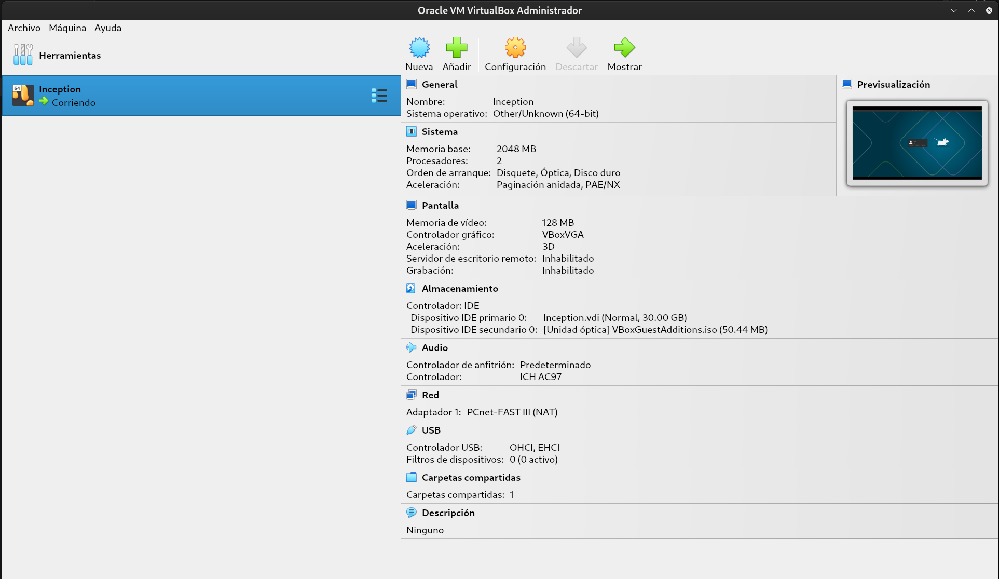
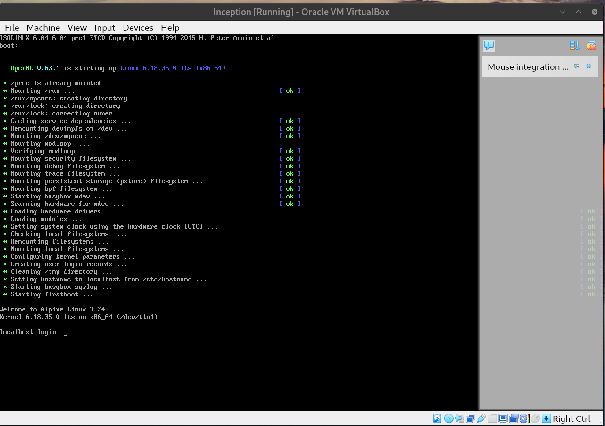
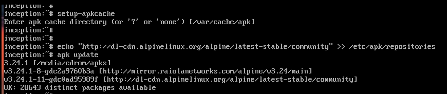
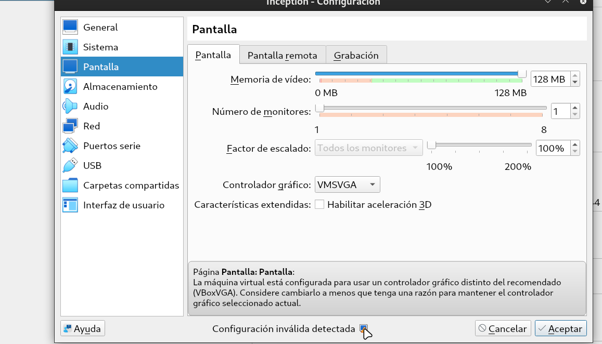
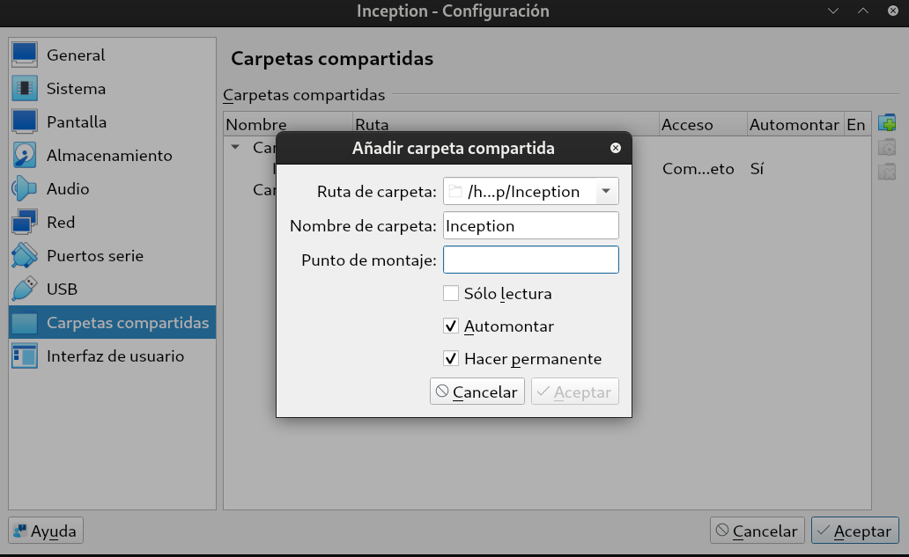
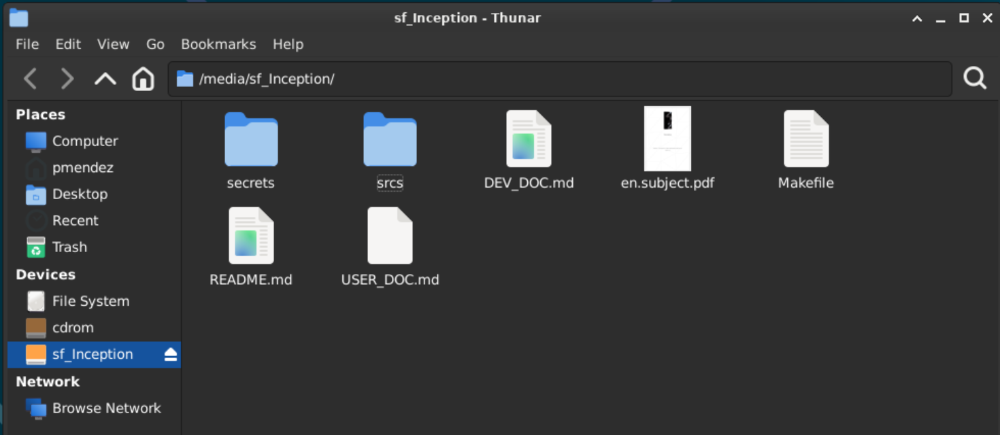
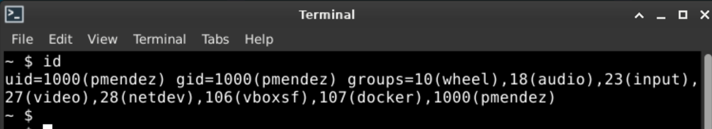
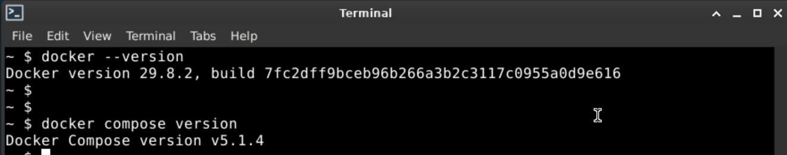

# Developer Documentation

This document explains, step by step, how to set up the environment from scratch, how the project works inside, how to build and run it, and how to manage its containers and data.

**Contents**

1. [Prerequisites](#1-prerequisites)
2. [Virtual machine setup](#2-virtual-machine-setup)
3. [Docker installation](#3-docker-installation)
4. [Domain name](#4-domain-name)
5. [Editor (optional)](#5-editor-optional-vs-code-via-flatpak)
6. [How the project works](#6-how-the-project-works)
7. [Project files, one by one](#7-project-files-one-by-one)
8. [Configuration from scratch: `.env` and secrets](#8-configuration-from-scratch-env-and-secrets)
9. [Build and run](#9-build-and-run)
10. [Managing containers, volumes and network](#10-managing-containers-volumes-and-network)
11. [Data persistence](#11-data-persistence)
12. [Troubleshooting](#12-troubleshooting)

---

## 1. Prerequisites

| Component | Version / Notes |
|---|---|
| Host hypervisor | VirtualBox |
| Guest OS | Alpine Linux with XFCE |
| Container engine | Docker + Docker Compose plugin |
| Base image of every container | `alpine:3.23` (penultimate stable Alpine, as required by the subject) |
| Editor (optional) | VS Code (via Flatpak) |

> The VM user is `pmendez`: the 42 login is `pmendez-`, but a trailing hyphen causes problems in a Linux username. The data folder is in that user's home, `/home/pmendez/data`, and the domain uses the full login, `pmendez-.42.fr`.

---

## 2. Virtual machine setup

### 2.1 Create the VM

1. Download an Alpine Linux ISO from [https://alpinelinux.org/downloads/](https://alpinelinux.org/downloads/).

2. Create a new VirtualBox VM (Linux, other 64-bit) with at least 2 CPUs, 4 GB RAM and 20 GB disk.


3. Boot the VM.





4. Install Alpine Linux from the official ISO using `setup-alpine`.



5. Install a desktop environment:

To make it possible to use graphical applications, you need to change this on VM settings: *Settings → Screen → Graphics Controller → VBoxVGA*.

Change it from `VBoxVGA` to `VMSVGA` and also, you need to increase the video memory up to 128, for example.



To install XFCE, run:

```sh
setup-desktop xfce
```

### 2.2 Create the user and grant sudo

Run as `root`:

```sh
apk add sudo
adduser pmendez
adduser pmendez wheel
visudo
```

In `visudo`, make sure this line is present and uncommented (the `%` means *group*):

```
%wheel ALL=(ALL:ALL) NOPASSWD: ALL
```

### 2.3 Enable the community repository

Edit `/etc/apk/repositories` and uncomment the line ending in `/community`, then:

```sh
sudo apk update
```

### 2.4 Shared folder with the host (VirtualBox)

1. In VirtualBox: *Settings → Shared Folders →* add the project folder, name it `Inception`, check *Auto-mount*.



2. In the VM, install the guest additions and add the user to the `vboxsf` group:

```sh
sudo apk add virtualbox-guest-additions
sudo rc-update add virtualbox-guest-additions default
sudo adduser pmendez vboxsf
sudo reboot
```


The project is then available at `/media/sf_Inception`.



> Group changes only apply after logging out and back in. Check with `id`.



---

## 3. Docker installation

```sh
sudo apk add docker docker-cli-compose
sudo rc-update add docker default     # start Docker on every boot
sudo rc-service docker start          # start it now
sudo adduser pmendez docker          # use docker without sudo
```

Log out and back in, then verify:

```
docker --version
docker compose version
```



```sh
docker run --rm hello-world
```

---

## 4. Domain name

The site must be reachable at `pmendez-.42.fr`. That name does not exist on the Internet, so we tell the VM that it points to itself (`127.0.0.1`):

```sh
echo "127.0.0.1 pmendez-.42.fr" | sudo tee -a /etc/hosts
```

---

## 5. Editor (optional): VS Code via Flatpak

The official VS Code build does not run natively on Alpine (musl), so it is installed through Flatpak:

```sh
sudo apk add flatpak dbus dbus-x11 xdg-desktop-portal xdg-desktop-portal-gtk
sudo rc-update add dbus default
sudo rc-service dbus start
sudo flatpak remote-add --if-not-exists flathub https://flathub.org/repo/flathub.flatpakrepo
sudo flatpak install -y flathub com.visualstudio.code
sudo reboot
```

Optional `code` command:

```sh
printf '#!/bin/sh\nexec flatpak run com.visualstudio.code "$@"\n' | sudo tee /usr/local/bin/code
sudo chmod +x /usr/local/bin/code
```

---

## 6. How the project works

### 6.1 The big picture

The project runs three containers. Each one does **one** job:

| Container | Job | Port | Reachable from |
|---|---|---|---|
| `nginx` | Web server. Receives every request over HTTPS | 443 | The outside world (the **only** entry point) |
| `wordpress` | Runs the PHP code of WordPress (PHP-FPM) | 9000 | Only inside the Docker network |
| `mariadb` | Database: posts, users, settings | 3306 | Only inside the Docker network |

```
 Browser
    │  https://pmendez-.42.fr  (port 443, TLS)
    ▼
┌──────────────────────────── Docker network "inception" ────────────────────────────┐
│                                                                                     │
│   NGINX ──── "run index.php" (9000) ────▶ WORDPRESS ──── SQL (3306) ────▶ MARIADB   │
│     │                                         │                             │       │
└─────┼─────────────────────────────────────────┼─────────────────────────────┼───────┘
      │                                         │                             │
      └──────────▶  volume "wordpress"  ◀───────┘                volume "mariadb"
                 /home/pmendez/data/wordpress            /home/pmendez/data/mariadb
```

### 6.2 Two kinds of connection

The containers are connected in **two different ways**, and each one has a different purpose.

**1. The network: containers *talk* to each other.**
Docker creates a private network called `inception` and puts the three containers in it. Inside that network, each container can be reached by its **name**, as if it were a hostname:

- nginx sends PHP requests to `wordpress:9000` (`fastcgi_pass` in `nginx.conf`).
- WordPress connects to the database at `mariadb:3306` (`--dbhost` in `wp-installer.sh`).

Only nginx publishes a port to the host (`443:443`). Ports 9000 and 3306 are **not** reachable from outside the network.

**2. The volumes: containers *share files*.**
A volume is a folder on the VM that Docker plugs into one or more containers:

- The `wordpress` volume is mounted at `/var/www/html` in **both** nginx and wordpress. WordPress writes its files there, and nginx reads them from there. It is the same folder, not a copy.
- The `mariadb` volume is mounted at `/var/lib/mysql` in mariadb. The database files live there.

Because the data lives on the VM and not inside the containers, it **survives** when containers are stopped, removed or rebuilt.

### 6.3 What happens when someone visits the site

1. The browser asks for `https://pmendez-.42.fr/`. The request reaches **nginx** on port 443.
2. nginx checks the URL against its config:
   - A static file (CSS, image, JS)? nginx reads it from `/var/www/html` (the shared volume) and sends it back. PHP is not involved.
   - A `.php` file, or a "pretty" URL like `/hello-world/`? nginx forwards the request to **PHP-FPM** at `wordpress:9000`.
3. PHP-FPM runs `/var/www/html/index.php`. It can find it because it sees the same shared volume.
4. WordPress needs the posts, so it queries **MariaDB** at `mariadb:3306`.
5. PHP builds the HTML page and returns it to nginx, which sends it to the browser.

### 6.4 Build time vs. start time

Each service has two moments, and confusing them is the most common source of errors:

| | **Dockerfile** | **Script in `tools/`** |
|---|---|---|
| When it runs | Once, when the image is built (`make build`) | Every time the container starts (`make`) |
| What it does | Installs programs, copies config files | Configures the service, then starts it |
| Has access to secrets, `.env`, volumes, other containers? | **No** | **Yes** |

This is why WordPress cannot be fully installed in the Dockerfile: at build time the database is not running and the passwords are not available.

### 6.5 PID 1: the main process of a container

#### What PID 1 is

Every running program is a **process**, and every process has a number: its **PID** (*Process ID*). The first process started inside a container gets the number **1**. It is the container's **main process**.

Docker follows one simple rule:

> **A container lives exactly as long as its PID 1 lives.** When PID 1 ends, the container stops.

So PID 1 must be the server itself (nginx, PHP-FPM, MariaDB), and it must keep running.

#### Rule 1: the server must run in the foreground

Many servers, when started, go to the **background** (they become a *daemon*): they create a copy of themselves that keeps working, and the original process ends. On a normal computer this is fine. In a container it is not:

```
Server in the background:
  PID 1 = nginx  →  creates a copy in the background  →  PID 1 ends
  Docker: "PID 1 has ended"  →  stops the container ❌

Server in the foreground:
  PID 1 = nginx  →  keeps working itself
  Docker: "PID 1 is alive"   →  the container keeps running ✅
```

That is why every server is started in the **foreground**:

| Container | PID 1 | How it stays in the foreground |
|---|---|---|
| nginx | `nginx -g "daemon off;"` | `daemon off;` = "do not go to the background" |
| wordpress | `php-fpm83 -F` | `-F` = *foreground* |
| mariadb | `mariadbd --user=mysql` | `mariadbd` stays in the foreground by default |

#### Rule 2: PID 1 receives the stop signals

A **signal** is a message sent to a process. Two matter here:

| Signal | Meaning | What the process can do |
|---|---|---|
| `SIGTERM` | "Please stop" | Finish its current work, save, close its files, then exit |
| `SIGKILL` | "Stop now" | Nothing: it is killed instantly |

When a container is stopped (`make down`, `docker stop`), Docker:

1. Sends `SIGTERM` **only to PID 1**.
2. Waits up to **10 seconds**.
3. If the container is still running, sends `SIGKILL`.

So PID 1 must be the server, because it is the only process that gets the "please stop" message:

```
✅ The server is PID 1:
Docker ──SIGTERM──▶ PID 1 = mariadbd
                    finishes writing, closes the database, exits
                    → clean stop in 1-2 seconds

❌ A script is PID 1 and the server is its child:
Docker ──SIGTERM──▶ PID 1 = sh initialize.sh   (the shell ignores it)
                         └── mariadbd           (never receives it)
        ...10 seconds...
Docker ──SIGKILL──▶ everything is killed instantly
                    → MariaDB may be stopped in the middle of a write
```

#### How this project does it: `exec`

The WordPress and MariaDB containers start with a script (`tools/*.sh`), so at first **the script** is PID 1. The script:

1. Does its one-time setup (install WordPress, create the database).
2. Ends with `exec <server>`:

```sh
exec mariadbd --user=mysql     # mariadb/tools/initialize.sh
exec php-fpm83 -F              # wordpress/tools/wp-installer.sh
```

`exec` **replaces** the script with the server. It does not start a new process: the same process, with the same PID 1, now runs the server. Without `exec`, the server would be a child of the script, and the script would stay as PID 1 (the bad case above).

nginx does not need a script: the Dockerfile's `CMD` starts nginx directly, so it is PID 1 from the beginning.

#### Why infinite loops are forbidden

A common shortcut is to start the server in the background and keep the container alive with a command that never ends: `tail -f`, `sleep infinity`, `while true`. The subject forbids it, and for good reasons:

- PID 1 is `tail`, not the server, so **the server never receives `SIGTERM`** and is killed after 10 seconds.
- **If the server crashes, the container keeps "running"** (the loop is still alive). Docker does not notice anything, and `restart: unless-stopped` never restarts it.

With the server as PID 1, the container's state is the server's state: if the server crashes, the container stops and Docker restarts it.

#### Check it

```sh
# Who is PID 1 in each container
for c in nginx wordpress mariadb; do
  printf '%s: ' $c; docker exec $c cat /proc/1/cmdline | tr '\0' ' '; echo
done

# A clean stop takes 1-2 seconds; ~10 seconds would mean PID 1 ignored SIGTERM
time docker stop mariadb
docker start mariadb
```

---

## 7. Project files, one by one

```
.
├── Makefile                         → entry point: builds and starts everything
├── DEV_DOC.md / USER_DOC.md / README.md
├── secrets/                         → passwords (ignored by git)
│   ├── db_password.txt
│   ├── db_root_password.txt
│   ├── wp_admin_password.txt
│   └── wp_user_password.txt
└── srcs/
    ├── .env                         → non-secret settings (ignored by git)
    ├── docker-compose.yml           → defines and connects the 3 containers
    └── requirements/
        ├── nginx/
        │   ├── Dockerfile
        │   └── conf/nginx.conf
        ├── wordpress/
        │   ├── Dockerfile
        │   └── tools/wp-installer.sh
        └── mariadb/
            ├── Dockerfile
            ├── conf/mariadb-conf.cnf
            └── tools/initialize.sh
```

Every service follows the same pattern: a **Dockerfile** with numbered steps, a **conf/** folder with configuration, and a **tools/** script that (1) reads the secrets, (2) does a one-time setup, and (3) `exec`s the server.

### 7.1 `srcs/docker-compose.yml`

Describes the three services and how they are connected.

| Key | What it does |
|---|---|
| `build: requirements/<service>` | Builds the image from our own Dockerfile (no ready-made images) |
| `image: <service>:inception` | The image gets the same name as its service (subject requirement), with the tag `inception`. Without a tag, Docker would name it `<service>:latest`, and the `latest` tag is forbidden |
| `container_name` | Fixed name, so we can write `docker exec nginx ...` |
| `ports: "443:443"` | Only in nginx: `VM port : container port` |
| `env_file: .env` | Loads the non-secret variables into the container |
| `secrets:` | Each secret file appears in the container as `/run/secrets/<name>` |
| `volumes:` | Plugs a named volume into a folder of the container |
| `networks: inception` | Puts the container in the private network |
| `depends_on:` | Start order: mariadb → wordpress → nginx |
| `restart: unless-stopped` | Docker restarts the container if it crashes |

The bottom of the file defines the shared pieces:

- **`networks.inception`**: a `bridge` network, Docker's private network type.
- **`volumes.wordpress` / `volumes.mariadb`**: named volumes whose data is stored in `/home/pmendez/data/...` (`driver_opts` with `device:` tells Docker *where* on the VM to keep the data).
- **`secrets`**: maps each secret name to its file in `../secrets/`.

### 7.2 nginx

**`Dockerfile`**

1. Installs `nginx` and `openssl`.
2. Creates a **self-signed TLS certificate** for `pmendez-.42.fr` (`openssl req -x509 ...`). "Self-signed" means no authority signed it, so the browser shows a warning. That is expected.
3. Copies `conf/nginx.conf` over Alpine's default site config.
4. Exposes port 443.
5. Starts nginx in the foreground (`daemon off;`).

**`conf/nginx.conf`**

| Directive | Meaning |
|---|---|
| `listen 443 ssl;` | Only HTTPS. There is no port 80 |
| `ssl_protocols TLSv1.2 TLSv1.3;` | Older, insecure TLS versions are refused |
| `root /var/www/html;` | Where the website files are: the shared `wordpress` volume |
| `try_files $uri $uri/ /index.php?$args;` | Is it a file? Serve it. A folder? Serve its index. Otherwise let WordPress (`index.php`) handle it |
| `location ~ \.php$` | For URLs ending in `.php`… |
| `fastcgi_pass wordpress:9000;` | …send them to PHP-FPM in the `wordpress` container |
| `fastcgi_param SCRIPT_FILENAME ...` | …and tell PHP-FPM which file to run (e.g. `/var/www/html/index.php`) |

### 7.3 WordPress

**`Dockerfile`**

1. Installs PHP 8.3, PHP-FPM, the PHP extensions WordPress needs, `curl` and the MariaDB client.
2. Links `php` → `php83`, because WP-CLI looks for a program called `php`.
3. Makes PHP-FPM listen on `9000` instead of `127.0.0.1:9000`, so other containers (nginx) can reach it.
4. Raises PHP's `memory_limit` to 512M. WP-CLI needs it to unpack WordPress.
5. Downloads **WP-CLI** (`/usr/local/bin/wp`), the command-line tool used to install WordPress.
6. Copies the start script.
7. Sets `/var/www/html` as the working directory (where the volume is mounted).
8. Exposes port 9000.
9. Runs the script on start.

**`tools/wp-installer.sh`**, run at every start:

1. Reads the three passwords from `/run/secrets/`.
2. Waits until MariaDB answers (`mariadb-admin ping`). On the very first start, the database needs a few seconds to initialise.
3. **Only if `wp-config.php` does not exist yet** (first start), installs WordPress:
   1. `wp core download`: downloads the WordPress files into the volume.
   2. `wp config create`: writes `wp-config.php` (database name, user, password, host `mariadb:3306`).
   3. `wp core install`: creates the tables in MariaDB, the site title and the **administrator** account.
   4. `wp user create`: creates the second, non-admin user (role `author`).
4. Gives the files to `nobody`, the user PHP-FPM runs as, so WordPress can write (uploads, plugins).
5. `exec php-fpm83 -F`: PHP-FPM becomes PID 1.

On the next starts `wp-config.php` already exists in the volume, so step 3 is skipped.

### 7.4 MariaDB

**`Dockerfile`**

1. Installs the MariaDB server and client.
2. Creates `/run/mysqld`, the folder for the local socket (used to connect from inside the container).
3. Copies `conf/mariadb-conf.cnf` over Alpine's default config, which blocks network connections.
4. Copies the start script.
5. Exposes port 3306.
6. Runs the script on start.

**`conf/mariadb-conf.cnf`**

| Option | Meaning |
|---|---|
| `bind-address = 0.0.0.0` | Accept connections from other containers (WordPress), not only from inside |
| `port = 3306` | Standard MariaDB port |
| `datadir = /var/lib/mysql` | Where the data is stored: the `mariadb` volume |
| `socket = /run/mysqld/mysqld.sock` | Local socket file for connections from inside the container |

**`tools/initialize.sh`**, run at every start:

1. Reads `db_password` and `db_root_password` from `/run/secrets/`.
2. **Only if `/var/lib/mysql/mysql` does not exist yet** (first start):
   1. `mariadb-install-db`: creates MariaDB's internal system tables.
   2. Starts a **temporary** MariaDB in the background, without network, only to configure it.
   3. Waits until it answers.
   4. Runs the SQL setup:
      - removes the anonymous users and the `test` database;
      - creates the WordPress database (`DB_NAME`);
      - creates the WordPress user (`DB_USER`) with access from any container (`'%'`);
      - sets the `root` password.
   5. Shuts the temporary server down.
3. `exec mariadbd --user=mysql`: the real MariaDB becomes PID 1.

### 7.5 `Makefile`

See [section 9](#9-build-and-run).

---

## 8. Configuration from scratch: `.env` and secrets

Configuration is split in two:

| | `srcs/.env` | `secrets/*.txt` |
|---|---|---|
| Contains | Non-sensitive settings (names, domain, emails) | Passwords only |
| Reaches the container as | Environment variables | Files in `/run/secrets/<name>` |
| Visible with `docker inspect`? | Yes | No |
| In git? | **No** (`.gitignore`) | **No** (`.gitignore`) |

> No password may ever appear in a Dockerfile, in `.env` or in git. Passwords found in the repository mean the project fails.

### 8.1 Create `srcs/.env`

```sh
cat > srcs/.env << 'EOF'
# Domain
DOMAIN_NAME=pmendez-.42.fr

# Database
DB_NAME=wordpress
DB_USER=wpuser

# WordPress (the admin username must NOT contain "admin")
WP_TITLE=Inception
WP_ADMIN_USER=pmendez_boss
WP_ADMIN_EMAIL=pmendez-@student.42.fr
WP_USER=pmendez_user
WP_USER_EMAIL=user@student.42.fr
EOF
```

| Variable | Used by | Meaning |
|---|---|---|
| `DOMAIN_NAME` | wordpress | Site URL (`https://$DOMAIN_NAME`) |
| `DB_NAME` | mariadb, wordpress | Name of the WordPress database |
| `DB_USER` | mariadb, wordpress | Database user WordPress connects with |
| `WP_TITLE` | wordpress | Site title |
| `WP_ADMIN_USER` / `WP_ADMIN_EMAIL` | wordpress | Administrator account. Must not contain `admin` / `Admin` / `administrator` |
| `WP_USER` / `WP_USER_EMAIL` | wordpress | Second, non-admin account |

### 8.2 Create the secrets

One file per password. Here they are generated randomly:

```sh
mkdir -p secrets
openssl rand -base64 18 > secrets/db_password.txt
openssl rand -base64 18 > secrets/db_root_password.txt
openssl rand -base64 18 > secrets/wp_admin_password.txt
openssl rand -base64 18 > secrets/wp_user_password.txt
chmod 600 secrets/*
```

| File | Name inside the container | Used by | Meaning |
|---|---|---|---|
| `db_password.txt` | `/run/secrets/db_password` | mariadb, wordpress | Password of `DB_USER` |
| `db_root_password.txt` | `/run/secrets/db_root_password` | mariadb | Password of MariaDB's `root` |
| `wp_admin_password.txt` | `/run/secrets/wp_admin_password` | wordpress | Password of `WP_ADMIN_USER` |
| `wp_user_password.txt` | `/run/secrets/wp_user_password` | wordpress | Password of `WP_USER` |

> The passwords are only applied on the **first** start. Changing a secret later does not change an existing database or WordPress install. To apply new values, reset the data ([section 11.3](#113-starting-again-from-zero)).

### 8.3 Check that nothing secret is tracked by git

```sh
git check-ignore -v srcs/.env secrets/db_password.txt   # both must be listed
git ls-files secrets srcs/.env                          # must print nothing
```

---

## 9. Build and run

Run everything from the project root.

### 9.1 Makefile targets

| Command | What it does |
|---|---|
| `make` | Creates the data folders, builds the 3 images, starts the containers |
| `make build` | Creates the data folders and builds the images (does not start them) |
| `make up-<service>` | Starts one service, e.g. `make up-nginx` |
| `make down` | Stops and removes the containers. **Data is kept** |
| `make clean` | `down` + `docker system prune -a --volumes -f` + deletes `/home/pmendez/data` (with `sudo`) |
| `make re` | `clean` then `make`: full rebuild from zero |

> ⚠️ `make clean` runs `docker system prune -a`, which removes **all** unused Docker images, containers and volumes on the machine, not only this project's. It also deletes the website and the database.

### 9.2 What `make` does, step by step

1. **`create_dirs`**: `mkdir -p /home/pmendez/data/wordpress /home/pmendez/data/mariadb`. The volumes need these folders to exist.
2. **`build`**: `docker compose -f srcs/docker-compose.yml build` runs the three Dockerfiles.
3. **`up -d`**: creates the network, the volumes and the containers, then starts them in the background, in `depends_on` order:
   1. **mariadb**: on the first start it initialises the database (a few seconds), then serves on 3306.
   2. **wordpress**: waits for MariaDB; on the first start it downloads and installs WordPress (about a minute), then PHP-FPM serves on 9000.
   3. **nginx**: serves HTTPS on 443.

### 9.3 Check that it works

```sh
docker ps                                  # the 3 containers must be "Up"
docker logs wordpress                      # must end with "Arrancando PHP-FPM..."
docker logs mariadb                        # must show "ready for connections"
```

Then open `https://pmendez-.42.fr` in the browser. The browser warns about the self-signed certificate: accept it to continue.

| URL | Page |
|---|---|
| `https://pmendez-.42.fr` | The website |
| `https://pmendez-.42.fr/wp-admin` | Administration panel (log in with `WP_ADMIN_USER` and `secrets/wp_admin_password.txt`) |

Check TLS from the terminal:

```sh
curl -kI https://pmendez-.42.fr                       # works
curl -kI --tlsv1.1 --tls-max 1.1 https://pmendez-.42.fr  # must fail (TLS 1.1 refused)
curl -I http://pmendez-.42.fr                         # must fail (no port 80)
```

---

## 10. Managing containers, volumes and network

The compose project is called `srcs` (the name of the folder that holds `docker-compose.yml`), so Docker prefixes the volumes and the network with `srcs_`.

### 10.1 Containers

```sh
docker ps                                   # running containers
docker ps -a                                # also the stopped ones
docker compose -f srcs/docker-compose.yml logs -f        # follow all logs
docker logs -f wordpress                    # follow one container's logs
docker exec -it wordpress sh                # open a shell inside a container
docker compose -f srcs/docker-compose.yml restart nginx  # restart one service
docker exec nginx cat /proc/1/cmdline | tr '\0' ' '     # see a container's PID 1
```

### 10.2 WordPress (WP-CLI inside the container)

```sh
docker exec wordpress wp user list --allow-root        # list WordPress users
docker exec wordpress wp option get siteurl --allow-root
```

### 10.3 Database

```sh
# Connect as root (asks nothing: the password is read from the secret)
docker exec -it mariadb sh -c 'mariadb -u root -p"$(cat /run/secrets/db_root_password)"'

# Inside MariaDB:
SHOW DATABASES;
SELECT User, Host FROM mysql.user;
USE wordpress; SHOW TABLES;
```

### 10.4 Volumes

```sh
docker volume ls                        # srcs_wordpress, srcs_mariadb
docker volume inspect srcs_wordpress    # "device" shows the folder on the VM
ls /home/pmendez/data/wordpress        # the WordPress files, seen from the VM
```

To see that both containers share the same files:

```sh
docker exec nginx     ls /var/www/html
docker exec wordpress ls /var/www/html  # same list
```

### 10.5 Network

```sh
docker network ls                       # srcs_inception
docker network inspect srcs_inception   # lists the 3 containers and their IPs
```

---

## 11. Data persistence

### 11.1 Where the data lives

| Volume | Path in the container | Path on the VM | Contents |
|---|---|---|---|
| `srcs_wordpress` | `/var/www/html` (nginx and wordpress) | `/home/pmendez/data/wordpress` | WordPress files, `wp-config.php`, uploads |
| `srcs_mariadb` | `/var/lib/mysql` (mariadb) | `/home/pmendez/data/mariadb` | Database files |

Both are **named volumes** (declared under `volumes:` in `docker-compose.yml`), not bind mounts. `driver_opts.device` only tells Docker in which VM folder to keep their data.

### 11.2 What survives what

| Action | Containers | Data |
|---|---|---|
| A container crashes | Restarted automatically (`restart: unless-stopped`) | Kept |
| `make down` then `make` | Recreated | Kept: WordPress is **not** reinstalled |
| Rebuilding images (`make build`) | Recreated from the new image | Kept |
| Rebooting the VM | Restarted when Docker starts | Kept |
| `make clean` / `make re` | Removed | **Deleted** |

The start scripts detect existing data: MariaDB checks for `/var/lib/mysql/mysql`, WordPress checks for `wp-config.php`. If they exist, the one-time setup is skipped.

### 11.3 Starting again from zero

```sh
make down
sudo rm -rf /home/pmendez/data       # needs sudo: the files belong to the container users
docker volume rm srcs_wordpress srcs_mariadb
make
```

---

## 12. Troubleshooting

| Symptom | Cause | Fix |
|---|---|---|
| `wordpress` logs repeat `Esperando a MariaDB...` | MariaDB not ready yet, or wrong DB credentials | Wait a few seconds; check `docker logs mariadb`; check that `DB_USER` and `db_password` match |
| `Allowed memory size ... exhausted` during `wp core download` | PHP memory limit too low | Already fixed in the WordPress Dockerfile (step 4, `memory_limit = 512M`) |
| `This does not seem to be a WordPress installation` | A previous install stopped halfway and left files in the volume | Reset the data ([11.3](#113-starting-again-from-zero)) |
| `No space left on device` | The VM disk is full | Free space (`df -h`, `docker system df`) |
| `cannot expose privileged port 443` | Docker runs in rootless mode | Use a normal (rootful) Docker install, as in [section 3](#3-docker-installation) |
| `failed to mount local volume ... no such file or directory` | `/home/pmendez/data/...` does not exist | Run `make` (it creates the folders), and check that your VM user is `pmendez` |
| The browser cannot find `pmendez-.42.fr` | Missing `/etc/hosts` entry | See [section 4](#4-domain-name) |
| Browser warning about the certificate | The certificate is self-signed | Expected: accept it |
| A secret changed but nothing happened | Passwords are only applied on the first start | Reset the data ([11.3](#113-starting-again-from-zero)) |
| `make clean` fails with `Permission denied` on `/home/.../data` | The files belong to the container users (`mysql`, `nobody`) | `sudo rm -rf /home/pmendez/data` |
