# Evaluation Guide

Step-by-step guide to show the project during the defense. It follows the order of the evaluation scale. Every command is run from the root of the cloned repository, unless said otherwise.

For everyday use of the stack, see [USER_DOC.md](USER_DOC.md). 
For how it works inside, see [DEV_DOC.md](DEV_DOC.md).

> **Before the defense day:** make sure `/etc/hosts` contains `127.0.0.1 pmendez.42.fr`, that `curl` and `openssl` are installed in the VM (`sudo apk add curl openssl`), and that Docker starts on boot (`sudo rc-update add docker default`).

> **If long commands go back to the start of the line** and write over the prompt, the shell has the wrong terminal width. It is only visual: pressing Enter still runs the full command. To fix it, run `stty size` (it prints `rows cols`) and set the real size, for example `stty rows 40 cols 160`. Running `reset` also helps if the terminal is left in a strange state.

## Step 1. Clone the repository in an empty folder

Is just an example. No need to create a folder named `inception-eval`, it can be any name. The evaluator checks that the repository is cloned in an empty folder, so the `data` folder is not present yet.

```sh
cd ~ && rm -rf inception-eval && mkdir inception-eval && cd inception-eval
```

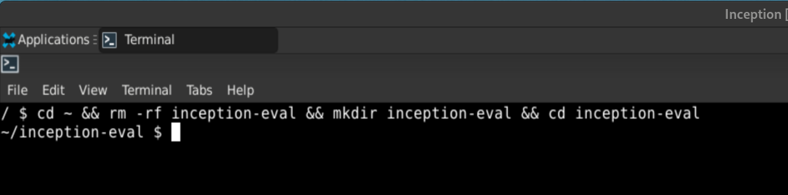

In order to be able to clone the repository, the Virtual Machine must have the SSH key of the GitHub account.
The following command creates a new SSH key pair in the VM, if it does not exist yet. The default location is `~/.ssh/id_rsa` and the default passphrase is empty (just press Enter when asked). The public key is in `~/.ssh/id_rsa.pub`.

NO NEED TO CREATE IT. IT IS ONLY DONE ONCE.

```sh
ssh-keygen
```

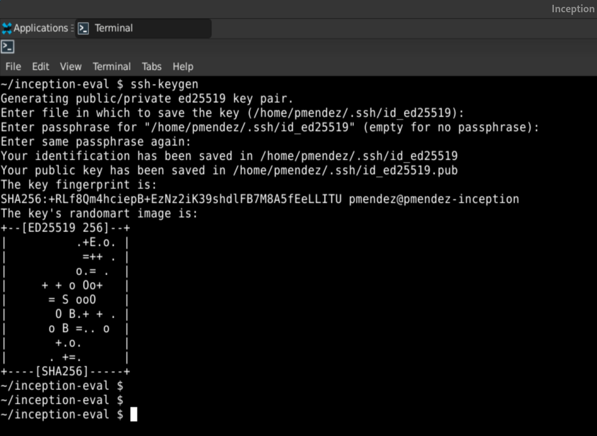

**That key must be added to the GitHub account, in *Settings → SSH and GPG keys → New SSH key*.**

```sh
git clone git@github.com:pauss12/Inception.git
```

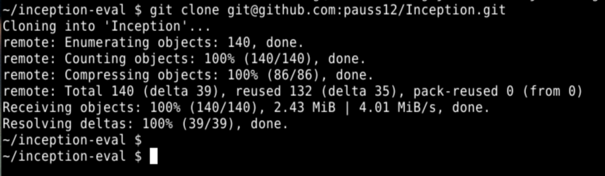

> If it fails with `Could not resolve hostname github.com` (the "access rights" message after it is generic), the VM has network but no DNS. Check it with `ping -c 2 8.8.8.8` (answers) and `cat /etc/resolv.conf` (shows `nameserver 10.0.2.3`). Fix it and clone again:
>
> ```sh
> printf "search 42madrid.com\nnameserver 10.51.1.253\nnameserver 8.8.8.8\n" | sudo tee /etc/resolv.conf
> sudo sed -i 's/^#RESOLV_CONF="no"/RESOLV_CONF="no"/' /etc/udhcpc/udhcpc.conf
> ```
>
> The second line keeps the change after a reboot. Full explanation in [DEV_DOC.md, Check 1b](DEV_DOC.md#check-1b-dns).

It must show the three folders: `Inception`, `srcs`, `secrets` (the last one is empty). The evaluator checks that no credentials are in git:
Makefile, srcs/, README.md, USER_DOC.md, DEV_DOC.md

```sh
cd Inception
ls -la
```

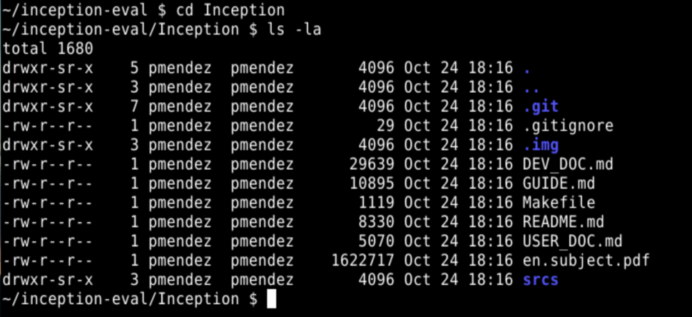

It must print nothing: no credentials in git

```sh
git ls-files secrets srcs/.env
```

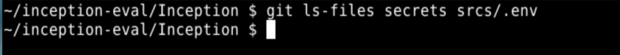

## Step 2. Clean Docker and the old data

The evaluator runs the cleaning command of the scale:

```sh
docker stop $(docker ps -qa); docker rm $(docker ps -qa); docker rmi -f $(docker images -qa); docker volume rm $(docker volume ls -q); docker network rm $(docker network ls -q) 2>/dev/null
```

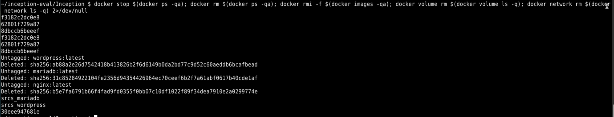

If you try to run the command above in a VM that has never run Docker, it fails with `docker: "stop" requires at least 1 argument.`. That is normal: there are no containers, images, volumes or networks to delete.

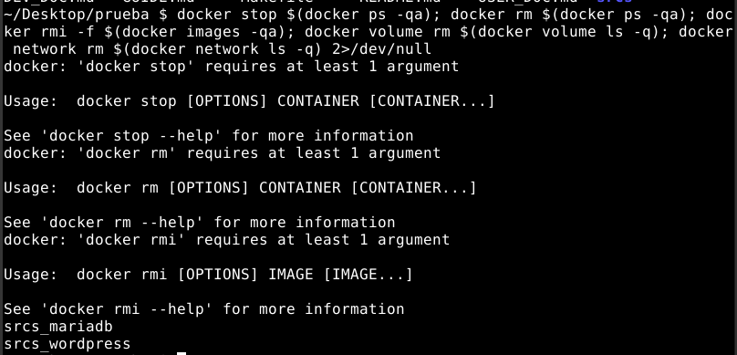

That command does not delete the data folder. Delete it too, so the site is installed from zero with the new passwords:

```sh
sudo rm -rf /home/pmendez-/data
```

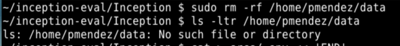

> If the old data is kept and the new secrets are different, WordPress cannot connect to the old database.

## Step 3. Create `.env` and the secrets

They are not in git (on purpose), so they are created now, in front of the evaluator:

```sh
cat > srcs/.env << 'END'
DOMAIN_NAME=pmendez.42.fr
DB_NAME=wordpress
DB_USER=wpuser
DB_PORT=3306
PHP_PORT=9000
NGINX_PORT=443
WP_TITLE=Inception
WP_ADMIN_USER=pmendez_boss
WP_ADMIN_EMAIL=pmendez-@student.42.fr
WP_USER=pmendez_user
WP_USER_EMAIL=user@student.42.fr
END

mkdir -p secrets
for s in db_password db_root_password wp_admin_password wp_user_password; do
  openssl rand -base64 18 > secrets/$s.txt
done
chmod 600 secrets/*
```

> If `openssl` is not found, install it first: `sudo apk add openssl`.

Check that everything was created:

```sh
cat srcs/.env
ls secrets/
```

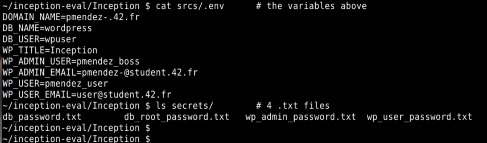

> ⚠️ Do not skip this step: without these files, `make` fails with `env file .../srcs/.env not found`.

## Step 4. Show the files the evaluator checks

| What the evaluator checks | Where to show it |
|---|---|
| No `network: host` and no `links:`; a `networks:` section exists | `srcs/docker-compose.yml` |
| No `--link` | `Makefile`, `srcs/docker-compose.yml` |
| One non-empty Dockerfile per service, each starting with `FROM alpine:3.23` | `srcs/requirements/*/Dockerfile` |
| No `tail -f`, no `sleep infinity`, no program started in the background | `CMD` of each Dockerfile and `tools/*.sh` |
| No password in any Dockerfile | `grep -ri password srcs/requirements/*/Dockerfile` only shows comments or variable names |

Quick checks:

Must print nothing: no `network: host`, no `links:`, no `--link` in the Makefile or docker-compose.yml

```sh
grep -rnE 'network: *host|links:|--link' Makefile srcs/
```

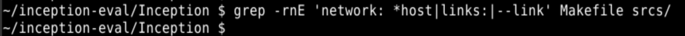

Must print nothing: no `tail -f`, no `sleep infinity`, no `while true` in the source files

```sh
grep -rnE 'tail -f|sleep infinity|while true' srcs/
```

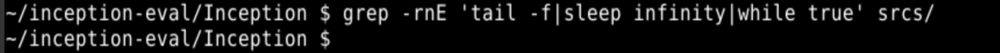

The following should output: alpine:3.23 in the 3 files
```sh
grep -n '^FROM' srcs/requirements/*/Dockerfile
```

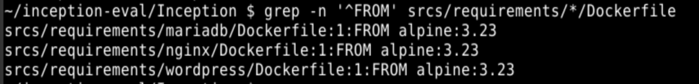

Points to explain:

- `sh /wp-installer.sh` uses `sh` **only to run a script**, which the scale allows.
- The `until mariadb-admin ping ...` loop in `wp-installer.sh` is **not** an infinite loop: it only waits until MariaDB answers, then the script continues and ends with `exec`.
- Each script ends with `exec <server>`, so the server is PID 1 in the foreground (see [DEV_DOC.md, section 6.5](DEV_DOC.md#65-pid-1-the-main-process-of-a-container)).

## Step 5. Run the Makefile

```sh
make
```

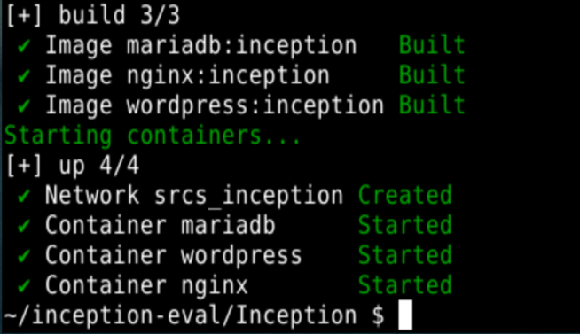

Wait about a minute (first install), then:

The nginx, wordpress, mariadb services must all be in state: "Up"

```sh
docker compose -f srcs/docker-compose.yml ps
```

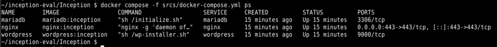

The nginx, wordpress, mariadb must have "inception" tag, not "latest"

```sh
docker images
```

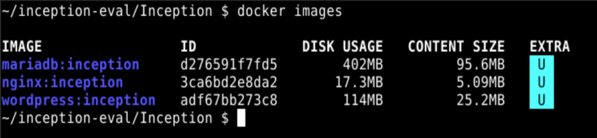

It must end with "Arrancando PHP-FPM..."

```sh
docker logs wordpress
```

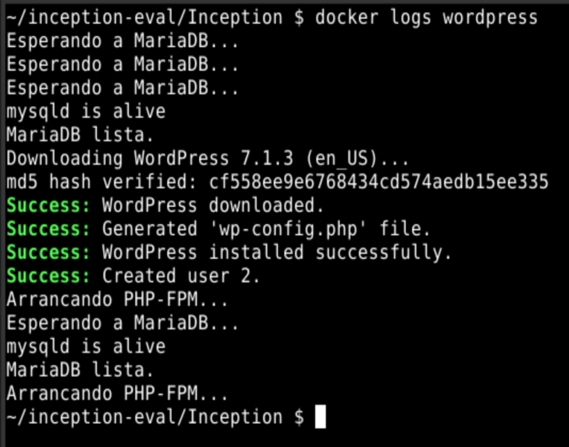

## Step 6. Explain the basics (activity overview)

Be ready to explain, with simple words:

| Question | Short answer |
|---|---|
| How Docker works | A container runs one program isolated from the rest of the system, using the host's kernel. It is created from an **image**, built from a **Dockerfile** |
| How docker compose works | One YAML file describes several containers, their network, volumes and secrets; `docker compose up` creates and starts all of them in order |
| Image with and without compose | Without compose: each image is built and run by hand with long `docker build` / `docker run` commands, and the network and volumes are created by hand. With compose: everything is declared once in `docker-compose.yml` and managed together |
| Docker vs VM | A VM emulates a whole computer with its own kernel (heavy, slow to boot). A container shares the host kernel (light, starts in seconds) |
| Directory structure | `Makefile` at the root drives everything; `srcs/` holds all the configuration; one folder per service in `srcs/requirements/` with its `Dockerfile`, `conf/` and `tools/`; `secrets/` holds the passwords outside git |

## Step 7. README and documentation

Check Italic in README.md

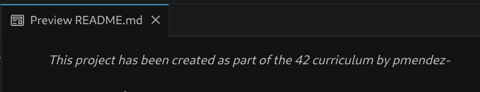

Check if the README.md contains the following sections: Description, Instructions, Resources (with the use of AI), Project description

```sh
grep -nE '^## |^### Use of AI' README.md
```

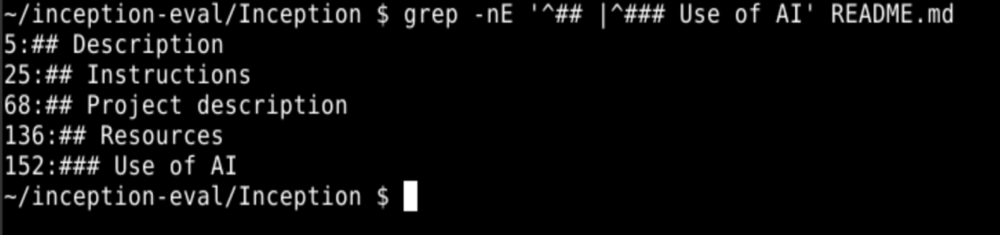

The evaluator must check that the USER_DOC.md and DEV_DOC.md files exist and are not empty:

```sh
ls -ltr USER_DOC.md DEV_DOC.md
```

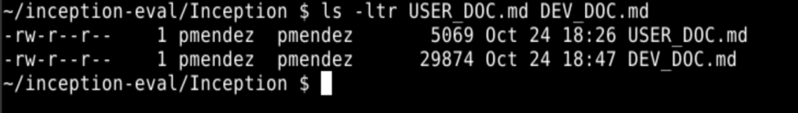

## Step 8. NGINX, port 443 only, TLS

The following command shows the three containers are running, and that nginx exposes port 443 only:

```sh
docker compose -f srcs/docker-compose.yml ps
```

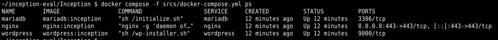

Before testing, the domain must point to the VM. Check `/etc/hosts` and add the line if it is missing (otherwise `curl` and `openssl` wait trying to resolve the name and the terminal looks frozen):

```sh
cat /etc/hosts
```

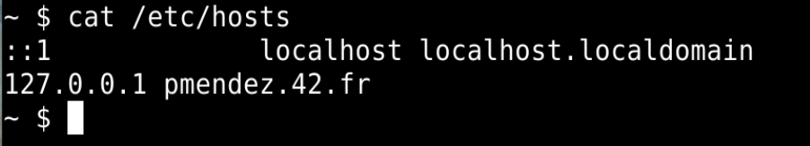

All the commands below have a time limit (`--max-time 5` / `timeout 5`), so they never block the terminal. If a command still gets stuck, press `Ctrl+C`.

1. **HTTP does not work** (no port 80):
	Must show "Connection refused"

   ```sh
   curl -I --max-time 5 http://pmendez.42.fr
   ```

2. **HTTPS works**: open **https://pmendez.42.fr** in the browser. Accept the self-signed certificate warning. The WordPress site appears directly, **not** the installation page.

   With `curl`, the same warning appears as an error:

   ```sh
   curl -I --max-time 5 https://pmendez.42.fr
   ```

   It fails with `curl: (60) SSL certificate OpenSSL verify result: self-signed certificate (18)`. This is **correct**: nginx answers over HTTPS with our own certificate, created by `tools/signCertificate.sh` during the build, not by an official authority, so `curl` does not trust it. The evaluation sheet allows it: *"The SSL/TLS certificate doesn't have to be recognized. A self-signed certificate warning may appear."* Add `-k` to connect anyway:

   ```sh
   curl -kI --max-time 5 https://pmendez.42.fr
   ```

   It must show `HTTP/1.1 200 OK`.

3. **TLS v1.2 / v1.3 are used**:

   ```sh
   timeout 5 openssl s_client -connect pmendez.42.fr:443 -tls1_2 </dev/null 2>/dev/null | grep -E 'Protocol|Cipher is'   # TLSv1.2 works
   timeout 5 openssl s_client -connect pmendez.42.fr:443 -tls1_3 </dev/null 2>/dev/null | grep -E 'Protocol|Cipher is'   # TLSv1.3 works
   curl -kI --max-time 5 --tlsv1.1 --tls-max 1.1 https://pmendez.42.fr       # fails: TLS 1.1 is refused
   ```

   In the browser: click the padlock → *Connection* / *Certificate* details also shows the TLS version.

4. **The certificate is self-signed**: the subject (who the certificate is for) and the issuer (who signed it) are the same, `CN=pmendez.42.fr`:

   ```sh
   timeout 5 openssl s_client -connect pmendez.42.fr:443 </dev/null 2>/dev/null | openssl x509 -noout -subject -issuer
   ```

5. Show the TLS lines in `srcs/requirements/nginx/conf/nginx.conf`: `listen 443 ssl;` and `ssl_protocols TLSv1.2 TLSv1.3;`.

## Step 9. Docker network

```sh
docker network ls                          # srcs_inception
docker network inspect srcs_inception      # the 3 containers are inside
```

Explanation: the three containers are in a private network created by Docker. Inside it they find each other **by name** (`wordpress:9000`, `mariadb:3306`). From outside, only nginx's port 443 is reachable.

## Step 10. WordPress, PHP-FPM and its volume

1. Show that the WordPress Dockerfile installs **no nginx** (only PHP, PHP-FPM, WP-CLI).
2. Volume:

   ```sh
   docker volume ls                         # srcs_wordpress, srcs_mariadb
   docker volume inspect srcs_wordpress     # "device": "/home/pmendez-/data/wordpress"
   ```

3. **Comment with the normal user**: open https://pmendez.42.fr/wp-login.php, log in as `pmendez_user` (password: `cat secrets/wp_user_password.txt`), open the "Hello world!" post and add a comment.
   If the comment shows *"Your comment is awaiting moderation"*, that is the normal WordPress behaviour: the administrator approves it in the next step.
4. **Administrator**: log out, log in as `pmendez_boss` (password: `cat secrets/wp_admin_password.txt`). The username does not contain "admin". The dashboard opens at https://pmendez.42.fr/wp-admin.
   - If the comment was pending: *Comments* → *Approve*.
5. **Edit a page**: *Pages* → *Sample Page* → change the text → *Save* / *Update*. Open the page on the website and show the change.

## Step 11. MariaDB and its volume

1. Show that the MariaDB Dockerfile installs **no nginx**.
2. Volume:

   ```sh
   docker volume inspect srcs_mariadb       # "device": "/home/pmendez-/data/mariadb"
   ```

3. **Log in to the database** (the password is in `secrets/db_password.txt`):

   ```sh
   cat secrets/db_password.txt
   docker exec -it mariadb mariadb -u wpuser -p
   ```

   Then, inside MariaDB:

   ```sql
   SHOW DATABASES;
   USE wordpress;
   SHOW TABLES;                                  -- wp_posts, wp_users, wp_comments...
   SELECT user_login FROM wp_users;              -- pmendez_boss, pmendez_user
   SELECT comment_content FROM wp_comments;      -- the comment from step 10
   EXIT;
   ```

   The database is not empty. Root also has a password: `mariadb -u root` without password is refused.

## Step 12. Persistence

```sh
sudo reboot
```

After the reboot, go back to the repository folder:

```sh
docker ps          # the containers start again by themselves (restart: unless-stopped)
make               # if they are not running, start them
```

Open https://pmendez.42.fr again: the edited page and the comment are still there, and the admin can still log in. `docker logs wordpress` shows no new installation (`wp-config.php` already existed in the volume).

## Step 13. Configuration modification

The evaluator asks to change the configuration of one service, for example a port. The data is kept: a rebuild does not touch the volumes. After any change:

```sh
make down && make
```

### Example A: change NGINX's port (443 → 8443)

1. `srcs/.env`: `NGINX_PORT=443` → `NGINX_PORT=8443`
2. `make`: the build writes the new port in nginx (`listen`, `EXPOSE`), docker compose publishes `8443:8443`, and on start `wp-installer.sh` updates WordPress's address (`home` and `siteurl`) to `https://pmendez.42.fr:8443`, so it does not redirect to port 443.
3. Open **https://pmendez.42.fr:8443**. `docker ps` shows `0.0.0.0:8443->8443/tcp` for nginx.

To undo it: `NGINX_PORT=443` in `srcs/.env` and `make` again.

### Example B: change PHP-FPM's port (9000 → 9001)

1. `srcs/.env`: `PHP_PORT=9000` → `PHP_PORT=9001`
2. `make`: the build writes the new port in PHP-FPM (`listen`, `EXPOSE`) and in nginx (`fastcgi_pass`), and recreates both containers.
3. Check it: `docker exec wordpress netstat -tln` shows `:9001`, and https://pmendez.42.fr still works.

### Example C: change MariaDB's port (3306 → 3307)

1. `srcs/.env`: `DB_PORT=3306` → `DB_PORT=3307`
2. `make`: the build writes the new port in MariaDB (`port`, `EXPOSE`), and on start `wp-installer.sh` uses it for the `ping` and updates `DB_HOST` in `wp-config.php` by itself.
3. Check it: `docker exec mariadb netstat -tln` shows `:3307`, and https://pmendez.42.fr still works.
